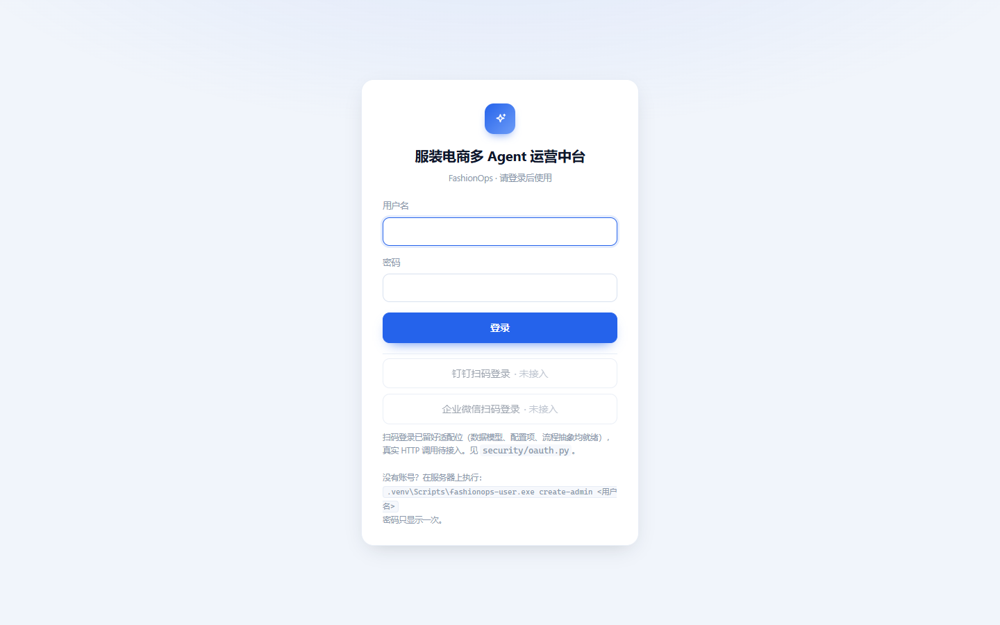
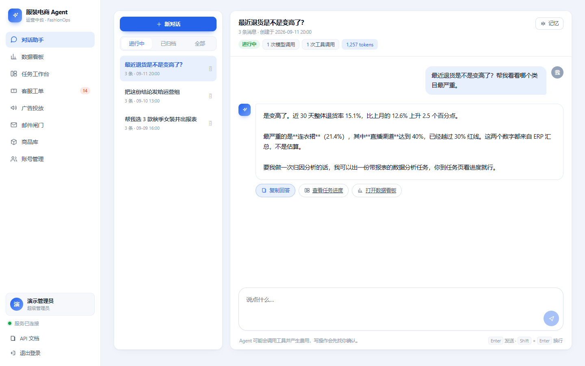
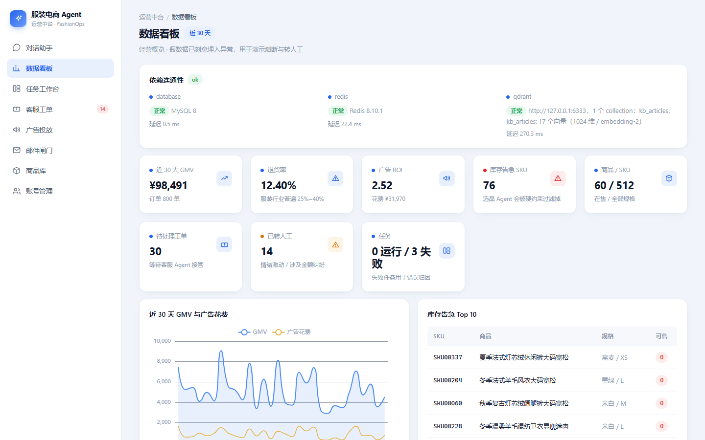
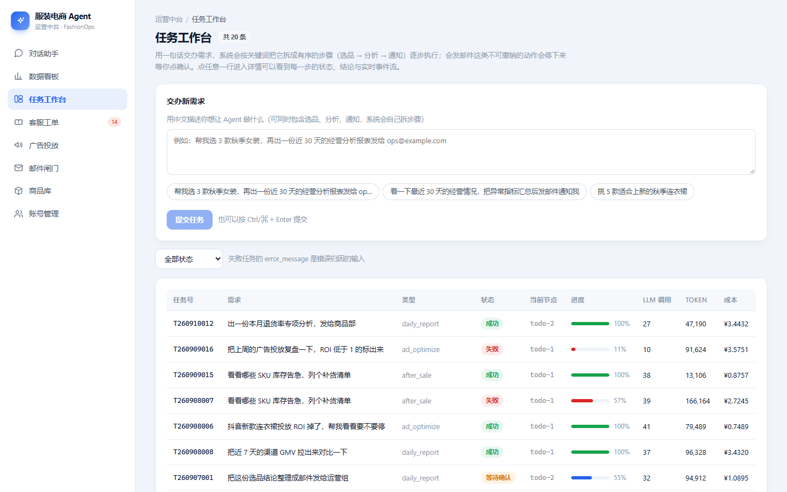
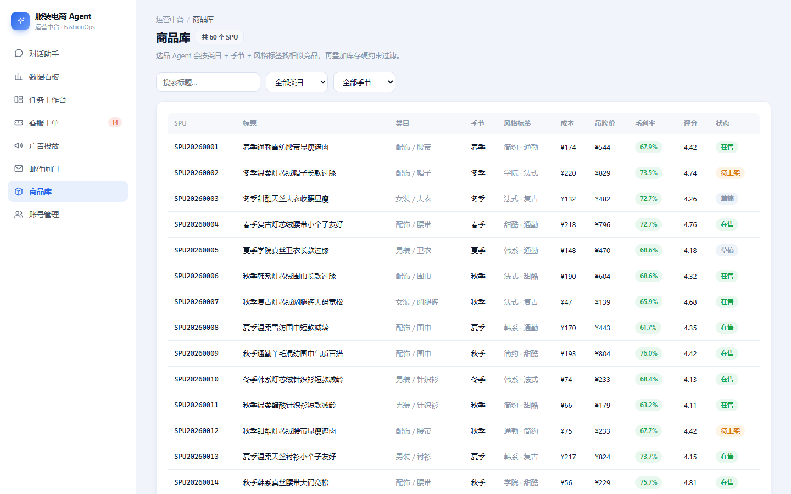
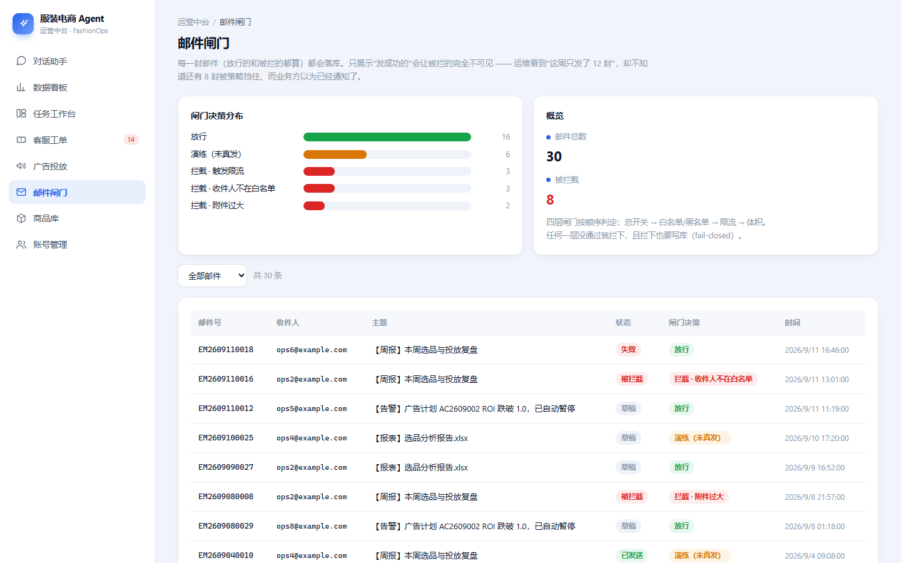
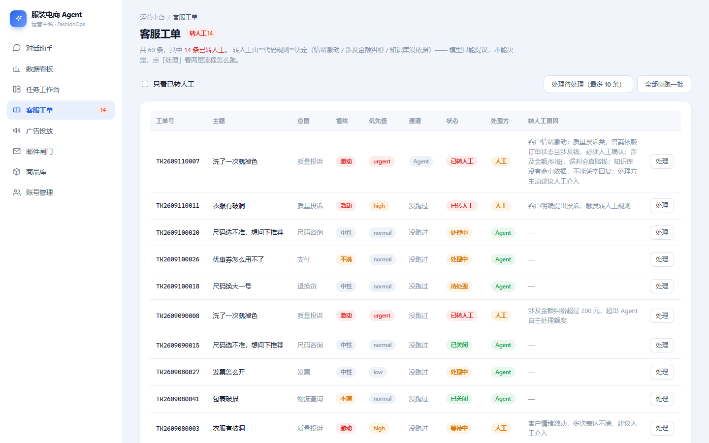

# Work Agent —— 企业办公 Agent 平台

一个能**真正干活**的办公 Agent：读取企业文档、生成 Word/Excel/PPT、收发邮件、管理日程，
并通过 MCP 协议接入企业既有系统。

> 目标场景：内网私有化部署 · 多用户 · 权限管理 · 国产大模型优先

---

## 这个仓库里有两个项目

| 目录 | 是什么 | 状态 |
| --- | --- | --- |
| **`platform/`** | **服装电商多 Agent 运营中台** —— 目前的主要产出 | ✅ 可跑，见下面的演示账号 |
| `mcp-servers/` | 办公能力 MCP 工具服务（文档处理 / 邮件 / 日历） | ✅ 可跑，74 个测试 |
| `agent-core/` · `web/` | 早期规划的占位目录，未开发 | ⬜ 空 |

### 想看 `platform/` 的效果

**打开 <http://localhost:3000>，用演示账号登录：**

| 用户名 | 密码 | 角色 |
| --- | --- | --- |
| `demo` | `FashionOps@2026` | `admin`（全部权限） |

> ⚠ 这是**本地演示账号**，明文写在 README 里，**不要用在任何公开部署上**。
> 真实凭据（数据库密码、邮箱授权码、模型 API Key）只在 `platform/.env` 里，
> 不进仓库。

### 界面预览

> 以下截图都取自**本地真实运行**的 `platform/`（灌入的演示数据），不是设计稿。

| | |
| --- | --- |
| **登录**<br> | **对话助手** —— Agent 调用 ERP / 知识库后给结论，并附下一步动作<br> |
| **数据看板** —— GMV / 退货率 / 广告 ROI / 库存告急，含 Redis·Qdrant 连通状态<br> | **任务工作台** —— Agent 拆解出的任务与执行进度<br> |
| **商品库** —— SKU 与库存<br> | **邮件闸门** —— 外发邮件的人工确认与限流<br> |
| **客服工单** —— 情绪/金额风险标注<br> | |

### 把 `platform/` 跑起来（命令都在 PowerShell 里实测过）

**有启动脚本，一条命令就行**（脚本在 `platform/deploy/scripts/`，不在仓库根目录）：

```powershell
cd "c:\Users\Administrator\Desktop\Work agent\platform\deploy\scripts"
.\start.ps1        # 数据层 → 后端 → 前端，全程幂等，可重复执行
.\stop.ps1         # 停止（加 -All 连 Redis/Qdrant 一起停）
```

首次运行前还要做一次（建库、灌演示数据）：

```powershell
.\init-mysql.ps1                                                  # 建库建号，会写 .env
cd "c:\Users\Administrator\Desktop\Work agent\platform"
.venv\Scripts\fashionops-seed.exe                                 # 灌假数据 + 补回演示账号
```

自检：<http://127.0.0.1:8000/health>（根路径）· 页面：<http://localhost:3000>

完整说明（页面导览、目录结构、命令速查、排错、设计原则）见
[`platform/README.md`](platform/README.md)。

### 把 `platform/` 的能力接到 MCP 客户端

平台把自己的**工具网关**暴露成了一个 MCP 服务器。外部 Agent（Claude Desktop /
Cursor / DeerFlow）能直接调用 ERP 查询、知识库检索、报表导出这些能力，
而且**调用链和平台内部完全一致** —— 权限 / 限流 / 熔断 / 幂等 / 审计一项不少。

```powershell
cd "c:\Users\Administrator\Desktop\Work agent\platform"

# 1) 装可选依赖。★ 必须 --all-extras，否则 ruff/pytest 会被卸掉
uv sync --all-extras

# 2) 给某个用户签一把 key（明文只显示一次，库里只有哈希）
.venv\Scripts\fashionops-user.exe apikey-create operator `
    --name "Claude Desktop" --scopes erp:read

# 3) 不启动服务也能先看这把 key 能看到什么
.venv\Scripts\python.exe -m fashionops.mcp.cli tools
```

客户端配置（路径换成你自己的）：

```json
{
  "mcpServers": {
    "fashionops": {
      "command": "D:/path/to/platform/.venv/Scripts/python.exe",
      "args": ["-m", "fashionops.mcp.cli", "serve"],
      "cwd": "D:/path/to/platform/backend",
      "env": { "FASHIONOPS_MCP_API_KEY": "fops_这里填签发的明文" }
    }
  }
}
```

> **key 是长期凭据**，所以它支持撤销和过期，也记最后使用时间：
> `fashionops-user apikey-list` / `apikey-revoke <前缀>`。
> 撤销**立即生效** —— 凭据是每次请求现解析的，不用重启服务端。
>
> 一把 key 能做的事恒为**其归属用户权限的子集**：`--scopes` 只能**收窄**，
> 塞一个用户本人没有的作用域也拿不到 —— 不存在"用 key 提权"。
>
> 写 MCP 服务时有一个坑：stdio 模式下 **stdout 是 JSON-RPC 通道**，
> 所以服务进程里只能用 logger（项目的 `setup_logging` 已经打到 stderr），
> 不能 `print()` —— 否则客户端会报莫名其妙的 "invalid JSON"。

---

## 技术栈

| 层 | 选型 | 说明 |
| --- | --- | --- |
| Agent 运行时 | **DeerFlow 2.0**（LangGraph + LangChain） | 字节开源，MIT，多智能体编排 / 沙箱 / 记忆 / RBAC |
| 工具协议 | **MCP**（Model Context Protocol） | 通过 FastMCP 实现，工具可被任意 MCP 客户端复用 |
| 工具服务 | **Python 3.11+ / FastMCP 4** | 本仓库主体 |
| 前端 | React / Next.js | 待开发 |
| 模型 | DeepSeek / 通义 / 智谱 / Kimi | OpenAI 兼容接口 |
| 可观测性 | OpenTelemetry（规划中） | 全链路追踪 |

## 仓库结构

```
Work agent/
├── mcp-servers/          # ★ 自研：办公能力 MCP 服务器（本仓库核心产出）
│   ├── src/office_mcp/
│   │   ├── common/       #   配置 / 路径沙箱 / 凭证隔离 / 审计
│   │   ├── docs/         #   文档处理（已可用）
│   │   ├── email/        #   邮件（开发中）
│   │   └── calendar/     #   日历（开发中）
│   ├── scripts/demo.py   #   端到端演示脚本
│   └── tests/            #   74 个测试用例
├── agent-core/           # 待开发：自研 Agent 层（模型路由 / 评测）
├── web/                  # 待开发：办公工作台前端
├── vendor/deer-flow/     # 第三方基座（gitignore，需手动克隆）
└── docs/                 # 选型调研与开发文档
```

## 快速开始

### 1. 克隆第三方基座

```bash
git clone --depth 1 https://github.com/bytedance/deer-flow.git vendor/deer-flow
```

### 2. 运行 MCP 工具服务

```bash
cd mcp-servers
uv venv --python 3.12
uv pip install -e ".[dev]"

# 端到端演示（会真实生成 Word / Excel / PPT）
uv run python scripts/demo.py

# 跑测试
uv run pytest -q
```

### 3. 作为 MCP 服务器接入 Agent

```json
{
  "mcpServers": {
    "office-docs": {
      "command": "python",
      "args": ["-m", "office_mcp.docs.server"],
      "cwd": "D:/path/to/mcp-servers",
      "env": { "OFFICE_MCP_WORKSPACE_ROOT": "D:/office-data" }
    }
  }
}
```

详见 [`mcp-servers/README.md`](mcp-servers/README.md)。

---

## 工程上值得说的几个点

### 1. 路径沙箱：防止模型越权读写

模型可能生成 `../../etc/passwd` 这类路径。所有文件操作先经 `resolve_in_root()`：

- 先 `resolve()` 解析符号链接与 `..`，**再做路径段前缀比较**
  —— 保证 `/data-evil` 不会被误判为 `/data` 的子目录
- 对不存在的目标，先解析父目录再拼文件名，避免"文件不存在就跳过校验"
- 区分 `path_violation`（越权）与 `file_not_found`（缺失）两种错误码，
  模型才知道该换路径还是该放弃

### 2. 凭证隔离：密钥永不进入模型上下文

- 密钥只从环境变量读取，**不出现在任何工具的入参签名里**
- 工具需要凭证时经 `SecretStore` 取用 `SecretLease`，`repr()` 强制输出 `***`
- 审计日志只记录凭证**名字**
- 测试用例 `test_no_credential_params_exposed` 会扫描所有工具的 JSON Schema，
  出现 `password` / `token` / `api_key` 等字段即失败

### 2.5 会给外部世界造成不可撤回影响的能力，必须装闸门

发邮件就是典型例子：邮件发出去就收不回来。所以 `office-email` 采用 **fail-closed** 设计 ——
**白名单为空就谁都发不出去**，而不是默认放行：

- `to` / `cc` / `bcc` 全部校验（只看 `to` 的话，把目标塞进 `cc` 就绕过了）
- 附件扩展名 + 大小双限（挡住 `.env`、私钥这类文件外发）
- 滑动窗口限流（挡住模型陷入循环反复发信）
- 被拒时 `hint` 指向 `save_email_draft`，让 Agent 仍有办法把事做完
- **`dry_run` 也计入限流** —— 否则离线永远验证不到限流，上线才第一次触发

### 3. 错误即提示：让模型能自我修复

工具返回值统一为：

```json
{"ok": false, "code": "file_not_found",
 "error": "文件不存在：outputs/周报.docx",
 "hint": "请先用 list_files 查看工作区下有哪些文件，再选择正确的路径。"}
```

`hint` 是给模型的**下一步动作建议**，能显著降低无效重试次数。

### 4. 全量审计

每次工具调用写一行 JSONL：工具名、参数（递归脱敏）、耗时、状态、`trace_id`。
业务异常与内部异常都记为 `error` 并带 `error_code`，便于监控面板正确统计成功率。
审计写入失败**不阻断业务**（best-effort）。

### 5. 原子写入

文档先写同目录临时文件再 `replace()`，进程中断不会留下损坏的半成品文件。

---

## 当前进度

| 模块 | 状态 | 测试 |
| --- | --- | --- |
| `common` 横切层（配置/沙箱/凭证/审计/工具装饰器） | ✅ 完成 | 覆盖 |
| `docs` 文档处理 MCP 服务器（7 个工具） | ✅ 完成 | 覆盖 |
| `email` 邮件 MCP 服务器（7 个工具 + 四层发送闸门） | ✅ 完成 | 覆盖 |
| `calendar` 日历 MCP 服务器（9 个工具 + 空闲时间计算） | ✅ 完成 | 覆盖 |
| 接入 DeerFlow（LangGraph 层） | 🚧 待开发 | — |
| OpenTelemetry 全链路追踪 | 🚧 待开发 | — |
| τ³-bench 评测流水线 | 🚧 待开发 | — |
| 办公 Skill（周报/纪要/邮件起草） | 🚧 待开发 | — |

**质量现状**：`ruff check` 全部通过 · `ruff format` 已统一 · `pytest` 297 passed / 1 skipped

**端到端演示**（全部不需要 API Key，也不需要真实邮箱/日历服务）：

```bash
cd mcp-servers
uv run python scripts/demo.py            # 文档处理：10 个场景
uv run python scripts/demo_email.py      # 邮件 + 四层发送闸门：11 个场景
uv run python scripts/demo_calendar.py   # 日历 + 空闲时间计算：12 个场景
```

---

## 文档索引

| 文档 | 内容 |
| --- | --- |
| [`docs/01-选型调研-第一轮.md`](docs/01-选型调研-第一轮.md) | 平台型项目横向对比 |
| [`docs/02-候选项目清单-按梯队.md`](docs/02-候选项目清单-按梯队.md) | 按梯队整理的可二开项目 |
| [`docs/03-简历项目候选-二次开发.md`](docs/03-简历项目候选-二次开发.md) | 面向 Agent 岗的选型标准 |
| [`docs/04-LangGraph系候选与组合方案.md`](docs/04-LangGraph系候选与组合方案.md) | LangGraph 生态核实 |
| [`docs/05-2026热门技术栈与项目.md`](docs/05-2026热门技术栈与项目.md) | MCP / A2A / Graphiti / OTel 等技术点 |
| [`docs/06-开发日志.md`](docs/06-开发日志.md) | 开发记录与踩坑 |

## 许可证

- 本仓库自有代码：MIT
- `vendor/deer-flow`：MIT（字节跳动），未修改，通过独立仓库获取
