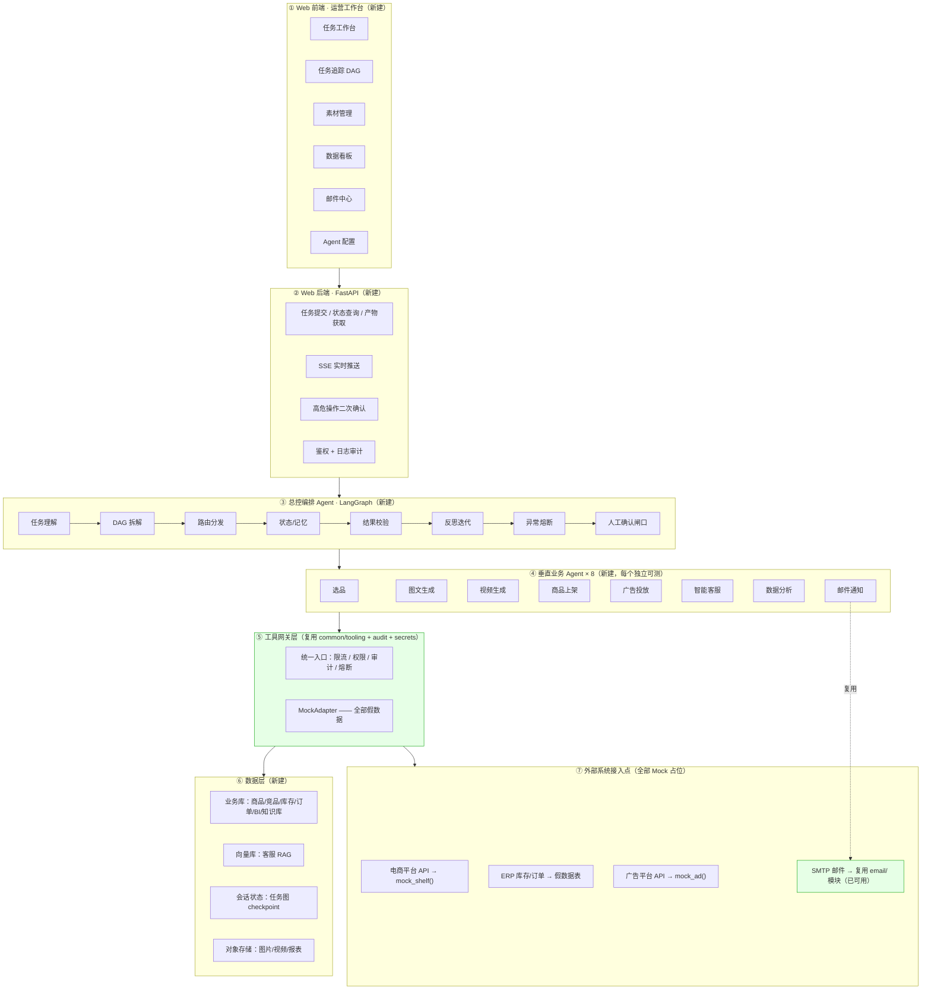

# 服装电商多 Agent 运营中台 — 项目规划

> 规划时间：2026-09-11　　状态：待拍板
> 前置代码：`mcp-servers/`（办公 MCP 工具层，23 个工具 / 297 个测试）

---

## 0. 结论先行

三句话：

1. **现有代码复用率约 45%** —— `common/` 横切层和 `email/` 模块几乎能直接搬过去当「工具网关」和「邮件通知 Agent」。
2. **你给的规格 + "覆盖所有热门技术" = 单人 3–6 个月**。必须分期，否则每个 Agent 都是空壳。
3. **Docker 是硬阻塞，但有零 Docker 的替代路线可以立刻开工**（见 §6）。

另外说一句：**"服装电商多 Agent 运营中台"这个选题比"办公 Agent"好得多**。
简历上"我做了个办公 Agent"已经泛滥，但"服装电商上新全链路 Agent 编排"业务具体、有行业感，
面试官更容易追问出深度，也更容易记住。

---

## 1. 现有代码复用性评估

### 1.1 直接复用（几乎不用改）

| 现有模块 | 行数 | 新项目里对应什么 | 改动量 |
| --- | --- | --- | --- |
| `common/tooling.py` `guard_tool` | 56 | **⑤ 工具网关层**的核心：审计/异常/返回值包装 | 小 |
| `common/audit.py` | 126 | 工具网关的审计日志（JSONL，可换 DB） | 小 |
| `common/errors.py` | 46 | 统一错误契约（`code` + `hint`） | 小 |
| `common/secrets.py` `SecretStore` | 82 | **外部 API 凭证隔离**（电商/广告平台密钥） | 小 |
| `common/paths.py` 路径沙箱 | 73 | 产物目录沙箱（图片/视频/报表落盘） | 小 |
| `common/config.py` | 114 | 配置骨架（加电商相关配置项） | 中 |
| `email/guard.py` **四层发送闸门** | 177 | 邮件通知 Agent 的发送策略 | 小 |
| `email/client.py` SMTP + IMAP | 674 | 邮件通知 Agent（规格说"SMTP 可真实可 mock"） | 小 |

> `email/` 整个模块（871 行）在规格里就是 **⑦ SMTP 邮件 → 可真实/可 mock**，
> 而且已经带了白名单/限流/附件策略，比规格要求的"打印日志"玩家级实现强得多。

### 1.2 部分复用（逻辑能借，接口要重写）

| 现有模块 | 可复用什么 | 要改什么 |
| --- | --- | --- |
| `docs/office.py` | Excel/Word 写入（**数据分析 Agent 出报表**用） | 工具签名面向文档场景，需按报表需求重写 |
| `docs/server.py` | 工具定义范式 | 新项目用内部网关，不一定再走 MCP |
| `calendar/timeutil.py` | 时区归一的写法 | 电商场景用"投放时间窗/订单时间"，需扩 |

### 1.3 用不上

| 现有模块 | 原因 |
| --- | --- |
| `calendar/` 整个模块（含 `slots.py` 算法） | 服装电商没有日程场景。**但算法思路（区间归并）在"广告投放时段优化"里能用上** |
| `docs/` 的 MCP 服务器形态 | 新项目是「Web + 编排平台」，不是「MCP 工具服务」 |

### 1.4 架构范式差异（要清楚）

```
现在：MCP 工具服务（被动被调用）        新项目：Agent 编排平台（主动决策 + 执行）
      Agent 在外面                          Agent 在里面
      没有 Web、没有数据库、没有编排          全都要有
```

所以**不是"改造现有项目"，而是"新建平台 + 移植现有模块"**。

---

## 2. 目标架构（对齐你的图，标注复用来源）



**绿色 = 复用现有代码。**

---

## 3. 热门技术点覆盖矩阵

你说要"包含 Agent 热门的所有技术"。逐项落到具体位置：

| # | 热门技术 | 落在这个项目的哪里 | 优先级 | 面试可讲什么 |
| --- | --- | --- | --- | --- |
| 1 | **LangGraph StateGraph** | ③ 总控 Agent 的 DAG 编排 | P0 | 状态机、条件边、子图、并发分支 |
| 2 | **HITL + `interrupt()`** | ③ 人工确认闸口（上架/改预算） | P0 | 中断与 checkpoint 恢复、审批流 |
| 3 | **工具网关（限流/权限/熔断）** | ⑤ 全部工具调用收口 | P0 | 工具治理、幂等、熔断降级 |
| 4 | **结构化输出 / Function Calling** | 所有 Agent 的输出契约 | P0 | Pydantic schema 约束、校验失败重试 |
| 5 | **多 Agent 协作** | ③→④ 分发、结果汇总 | P0 | supervisor 模式、上下文隔离 |
| 6 | **Mock 适配器 / 可插拔依赖** | ⑤ MockAdapter + ⑦ 接入点 | P0 | 依赖倒置、测试替身、灰度切换 |
| 7 | **SSE 流式推送** | ② → ① 任务进度实时推送 | P0 | 流式架构、断线重连 |
| 8 | **Context Engineering** | Agent 间上下文裁剪与压缩 | P1 | 长任务不爆上下文、上下文预算 |
| 9 | **RAG（混合检索 + 重排）** | ⑥ 客服知识库 | P1 | 切分策略、向量+BM25、rerank、召回率 |
| 10 | **Agent 记忆分层** | 短期（会话）+ 长期（历史偏好） | P1 | episodic / semantic 记忆、写入策略 |
| 11 | **可观测性（OTel）** | 全链路追踪：LLM + 工具 + 检索 | P1 | trace/span、token 成本归因、P95 延迟 |
| 12 | **Agent 评测** | 自建评测集 + LLM-as-judge | P1 | 成功率 / 步数 / 延迟 / 成本 四组数字 |
| 13 | **MCP 协议** | 把工具网关再暴露一层 MCP server | P2 | **现有 `mcp-servers/` 直接复用** |
| 14 | **A2A 协议** | Agent 间跨进程通信（可选） | P2 | agent↔agent vs agent↔tool |
| 15 | **持久化执行** | 长任务崩溃续跑（DBOS） | P2 | checkpoint、幂等、崩溃恢复成本 |
| 16 | **模型路由** | 按任务复杂度选大小模型 | P2 | 成本下降有数字 |
| 17 | **代码执行沙箱** | 数据分析 Agent 跑 Pandas | P2 | 隔离边界、资源限制 |
| 18 | **Agent Skills（SKILL.md）** | 每个垂直 Agent 的技能定义 | P2 | 渐进式披露、token 节省 |

> **重要提醒**：18 项全做 = 3–6 个月，而且每项都只能做到"能演示"。
> **做 10 项到能讲 20 分钟，比 18 项都只能讲 2 分钟强得多。**
> 建议 P0+P1 共 12 项，P2 视时间追加。

---

## 4. 分期计划

### 阶段 0：地基（1 周）——**必须先做，否则全是空中楼阁**

| 任务 | 产出 |
| --- | --- |
| 仓库重构 | `apps/` `agents/` `gateway/` `tool-services/` `mockdata/` `deploy/` |
| 数据层落地 | 建表 + 假数据 seed 脚本（商品/竞品/库存/订单/BI/知识库） |
| FastAPI 骨架 | 健康检查 + 任务 CRUD + SSE 通道 |
| 前端骨架 | 6 个页面路由 + 布局（数据先写死） |
| 模型接入 | DeepSeek/通义 API Key 配置 + 统一 model client |
| **可验证** | `GET /health` 通、前端能打开、假数据能查到 |

### 阶段 1：MVP 链路（2–3 周）——**最小可演示**

选 4 个 Agent 打通全链路（不选 9 个）：

| Agent | 为什么选它 |
| --- | --- |
| **选品 Agent** | 假数据打分，纯逻辑，最容易先跑通 |
| **数据分析 Agent** | 复用 `docs/office.py` 出 Excel 报表，产出可见 |
| **邮件通知 Agent** | **直接复用 `email/` 模块**，零新代码 |
| **总控编排 Agent** | DAG 编排 + HITL 闸口，技术含量最高 |

```
选品 → 数据分析 → 邮件通知      （3 节点 DAG）
       ↑ 人工确认闸口插在中间
```

| 同时完成 | 说明 |
| --- | --- |
| 工具网关 | 移植 `common/`，加限流 + 熔断 |
| DAG 可视化 | 前端画出任务图 + 节点实时状态 |
| 任务追踪页 | SSE 实时刷新 |

**可验证**：前端提交"帮我选 3 款秋季女装并出分析报告" → 看到 DAG 跑起来 → 中间弹确认 → 出 Excel 报表 + 收到邮件。

### 阶段 2：业务闭环（2–3 周）

补齐剩 5 个 Agent 的**核心逻辑**（外部 API 全 Mock）：

图文生成 → 视频生成 → 商品上架（mock_shelf）→ 广告投放（mock_ad）→ 客服 RAG

| 同时完成 | 说明 |
| --- | --- |
| RAG 检索链路 | 切分 + 向量 + BM25 + rerank |
| 素材管理页 | MinIO/本地文件 + 预览 |
| 数据看板 | 指标计算 + 图表 |

**可验证**：一句话跑通完整上新链路，全程可追踪、可干预。

### 阶段 3：深度打磨（2–3 周）——**简历上最能打的部分**

| 任务 | 为什么值得做 |
| --- | --- |
| OTel 全链路追踪 | 企业开发标准动作，面试常问 |
| **自建评测集 + 错误归因** | **产出数字，90% 候选人给不出来** |
| 模型路由 + 成本对比 | 有明确的成本下降数据 |
| 持久化执行 | 中断续跑，技术点稀缺 |
| 反思迭代闭环 | 数据分析结论 → 反馈给编排 Agent 调参 |
| 仓库改名 + README 重写 | 从"办公工具"变成"电商多 Agent 中台" |

---

## 5. 关键设计决策（需要你拍板）

| # | 决策点 | 选项 A | 选项 B | 我的建议 |
| --- | --- | --- | --- | --- |
| 1 | **数据层** | 装 Docker：PG + pgvector + Redis + MinIO（规格原样） | **零 Docker**：MySQL(已有) + Chroma + SQLite checkpoint + 本地文件 | **B**，见 §6 |
| 2 | **Agent 数量** | 9 个都做（每个都浅） | **先做 4 个做深，再补 5 个** | **先 4 后 5** |
| 3 | **Agent 间通信** | 同进程调用（简单快） | A2A 协议跨进程（技术亮点但复杂） | 先同进程，**留 A2A 接口** |
| 4 | **工具层形态** | 纯 Python 内部网关 | 内部网关 + MCP server 双轨 | **双轨**（MCP 是热门技术点） |
| 5 | **前端栈** | React + Vite | Next.js | 看你会哪个；我倾向 **React + Vite**（更轻、DAG 可视化库好找） |
| 6 | **现有 `mcp-servers/`** | 保留为独立目录 `tool-services/` | 拆散合进新架构 | **保留**（简历上多一个"可复用工具服务"的故事） |
| 7 | **模型** | DeepSeek（便宜） | 通义/智谱 | **DeepSeek**，开发期成本最低 |

---

## 6. 关于 Docker 硬阻塞（重要）

**现状**：Docker ✗、PostgreSQL ✗、Redis ✗、MinIO ✗，**但 MySQL 8.0 正在运行**。

### 两条路线

**路线 A：装 Docker，按规格原样做**
- 优点：完全符合你的架构图；pgvector 是业界标准
- 缺点：装 Docker Desktop 需要管理员权限 + 重启；WSL2 可能还要额外配置；
  一旦出问题会卡住整个项目（**已经卡了 3 轮了**）

**路线 B：零 Docker，全部用 pip 可装/本机已有的组件**

| 规格要求 | 替代方案 | 说明 |
| --- | --- | --- |
| PostgreSQL | **MySQL 8.0（本机已有）** 或 SQLite | 关系型够用，业务数据量很小 |
| pgvector | **ChromaDB**（`pip install chromadb`，嵌入式，无需服务） | 面试官关心"怎么检索/重排/评估"，不关心用哪个向量库 |
| Redis 会话 | **LangGraph SQLite checkpointer** + 进程内缓存 | LangGraph 原生支持，反而更贴合 |
| MinIO 对象存储 | **本地文件系统**（现在的 `workspace/` 沙箱） | 加一个 `StorageBackend` 抽象，将来换 MinIO 只改一个类 |

**我的建议：走 B。**

理由：
1. **立刻能开工**，不用等你装 Docker（这个阻塞已经存在 3 轮了）
2. 用 Chroma 而不是 pgvector **完全不影响面试价值** —— 而且你可以讲
   "抽象了向量后端接口，开发期用 Chroma，生产可切 pgvector"
3. 用 SQLite checkpointer 反而**更贴合 LangGraph 原生设计**，讲起来更正统
4. 路线 B 的接口抽象做好后，**将来切 A 只改 3 个适配器类**

**唯一必须你手动做的**：如果坚持路线 A，需要你自己装 Docker Desktop 并重启（安装程序要管理员权限，我不能代跑）。

---

## 7. 风险与取舍

| 风险 | 说明 | 对策 |
| --- | --- | --- |
| **范围失控** | 9 Agent + 全栈 + 18 项技术 = 做不完 | 严格按分期，每阶段有可演示产出 |
| **Docker 阻塞** | 已卡 3 轮 | 走路线 B |
| **模型 API Key** | Agent 编排绕不开，必须有 | 开发期用 DeepSeek，成本可控 |
| **前端工作量被低估** | 6 个页面 + DAG 可视化 ≈ 1 个月 | 用现成组件库（React Flow 画 DAG、ECharts 画图表） |
| **9 个 Agent 同质化** | 都是"读数据 → 算 → 出结果"，容易变流水账 | 每个 Agent 选一个**不同的技术点做深**（见 §8） |
| **Mock 数据太假** | 假数据没波澜就演示不出价值 | 假数据里**故意埋异常**（库存不足/ROI 暴跌/纠纷工单），才能展示熔断与转人工 |

---

## 8. 给 9 个 Agent 各配一个"技术尖点"

避免 9 个 Agent 都是流水账，每个 Agent 突出一个不同的技术：

| Agent | 技术尖点 |
| --- | --- |
| 总控编排 | **LangGraph DAG + HITL interrupt + 反思迭代** |
| 选品 | **多维度打分 + 约束过滤**（库存/产能硬约束，展示约束求解思路） |
| 图文生成 | **结构化 Prompt 工程 + 质检重绘闭环** |
| 视频生成 | **异步长任务 + 任务队列**（生成耗时长，正好演示持久化执行） |
| 商品上架 | **外部 API 占位 + 幂等设计**（重复上架不能出两个商品） |
| 广告投放 | **规则引擎 + 定时任务 + 区间优化**（复用日历模块的区间归并思路） |
| 智能客服 | **RAG 混合检索 + 重排 + 意图路由 + 转人工** |
| 数据分析 | **代码执行沙箱 + 指标计算 + 报表生成** |
| 邮件通知 | **四层发送闸门（已有）+ 模板引擎** |

---

## 9. 为什么需要 Docker？（把这件事讲透）

### 9.1 Docker 本身不是需求，它只是"一次把一堆中间件跑起来"的工具

你的架构图里 ⑥ 数据层写了 **PostgreSQL + pgvector + Redis**，⑦ 里还有 MinIO 的位置。
这四个**都是独立的服务进程** —— 不是 Python 包，`pip install` 装不上，必须：
下载安装 → 配置 → 启动服务 → 管理端口/账号/数据目录。

**在 Windows 上不用 Docker 的痛点**：

| 组件 | Windows 原生装法 | 问题 |
| --- | --- | --- |
| PostgreSQL | 官方有 Windows 安装包 | 要手动建库、建扩展、配 pgvector 编译 |
| **pgvector** | 需要单独编译或找预编译包 | **Windows 上最容易卡住的一环** |
| **Redis** | **官方不支持 Windows** | 只能装 WSL、或第三方移植版（Memurai / redis-windows），版本落后 |
| MinIO | 官方有 exe | 相对简单 |

所以 Docker 的价值就是：**一条 `docker compose up` 起 4 个服务，环境隔离、可复现、
删掉一行 `down -v` 就干净重来**，而且以后部署到服务器 / CI 用的是同一套配置。

> 一句话：**Docker 解决的是"环境一致性"，不是"功能有没有"。**

### 9.2 但对你这个项目，Docker 不是必需的

关键在于：**架构图上的组件名是"参考实现"，不是"硬性要求"。**
每一层都有一个"零安装"的等价替代：

| 架构图要求 | 它的职责 | 零安装替代 | 替代品怎么装 |
| --- | --- | --- | --- |
| PostgreSQL | 存业务数据（商品/订单/BI） | **SQLite**（或你已有的 MySQL） | `pip install sqlalchemy`，连文件都不用建 |
| pgvector | 向量检索（客服 RAG） | **ChromaDB** | `pip install chromadb`，嵌入式，**无服务进程** |
| Redis | 会话状态 / 任务图持久化 | **LangGraph SQLite checkpointer** | 内置，`pip install langgraph-checkpoint-sqlite` |
| MinIO | 存图片/视频/报表 | **本地文件系统** | 就是现在的 `workspace/` 沙箱 |

**为什么这是更好的选择，而不只是"退而求其次"**：

1. **SQLite 换成 PostgreSQL，只需要改一个连接字符串**（前提是用 SQLAlchemy —— 我们用）
2. **用 SQLite checkpointer 反而更贴合 LangGraph 原生设计** —— LangGraph 官方文档的默认示例就是它，
   讲起来比"我硬塞进 Redis"更正统
3. **面试官关心的是"你怎么做检索、怎么重排、怎么评估召回率"，不是"你用了 pgvector 还是 Chroma"**。
   你甚至能多讲一句加分项：
   > "我把向量后端抽象成 `VectorStore` 接口，开发期用 Chroma 嵌入式零依赖，
   > 生产切 pgvector 只改一个适配器类，检索与重排逻辑完全复用。"
4. **Docker 这个阻塞已经卡了 3 轮了**。继续等它，项目就停在规划阶段。

### 9.3 最终决定（可逆）

```
✅ 关系库    SQLAlchemy + SQLite（默认）    → 改 DATABASE_URL 即可切 MySQL / PostgreSQL
✅ 向量库    ChromaDB（嵌入式）             → 抽 VectorStore 接口，可切 pgvector
✅ 会话状态  LangGraph SQLite checkpointer  → 原生支持
✅ 对象存储  本地文件系统                   → 抽 StorageBackend 接口，可切 MinIO
✅ 缓存/队列 进程内 + SQLite                → 抽 CacheBackend 接口
```

**三个抽象接口（`VectorStore` / `StorageBackend` / `CacheBackend`）是这条路线的关键**：
它们让"切到 Docker 路线 A"变成改 3 个适配器类，而不是重写项目。

等到阶段 3 你随时想体验真实 PG + pgvector，`deploy/docker-compose.yml` 我也会一并写好，
你装完 Docker 直接 `up` 就行。**两边都不耽误。**

---

## 10. 已确认的决策（2026-09-11）

| 决策点 | 结论 |
| --- | --- |
| 数据层 | **零 Docker 路线**（SQLite + Chroma + SQLite checkpoint + 本地文件），保留 3 个抽象接口 |
| 时间预算 | **3 个月以上**，9 个 Agent 全覆盖 + 12 项 P0/P1 技术点 |
| 前端 | **全栈由我做**（React + Vite + React Flow 画 DAG + ECharts 画图表） |
| Agent 数量 | 9 个全做，但**分两批落地**（先 4 个打通闭环，再补 5 个） |
| 现有 `mcp-servers/` | 保留原地不动（它是独立可交付的"工具服务"，也是简历上的一个加分项） |

---

## 11. 12 周排期

| 周次 | 阶段 | 交付物 | 可验证标准 |
| --- | --- | --- | --- |
| **W1** | 阶段 0 地基 | 平台工程骨架 + 数据层（14 张表）+ 假数据 seed + FastAPI 骨架 + 前端骨架 | 假数据能查到、前端能打开、`/health` 通 |
| **W2** | 阶段 1 编排内核 | 工具网关（限流/权限/审计/熔断）+ 模型客户端 + LangGraph 状态定义 | 单测覆盖网关与状态机 |
| **W3** | 阶段 1 MVP-Agent | 选品 Agent + 数据分析 Agent + 邮件通知 Agent（复用 `email/`） | 三个 Agent 各自单测通过 |
| **W4** | 阶段 1 编排闭环 | 总控编排 Agent（DAG 拆解 + 路由 + 状态）+ 人工确认闸口 | **端到端：一句话跑通 3 Agent 链路** |
| **W5** | 阶段 1 前端 | 任务工作台 + DAG 可视化 + SSE 实时状态 + 邮件中心 | 前端能看到 DAG 实时跑动、能点确认 |
| **W6** | 阶段 2 业务闭环 A | 图文生成 Agent + 视频生成 Agent + 素材管理页 | 生成素材可在前端预览 |
| **W7** | 阶段 2 业务闭环 B | 客服 Agent（RAG：切分 + 向量 + BM25 + 重排） | 召回率有基线数字 |
| **W8** | 阶段 2 业务闭环 C | 商品上架 Agent（mock_shelf 幂等）+ 广告投放 Agent（mock_ad + 规则引擎） | 完整上新链路跑通 |
| **W9** | 阶段 2 前端 | 数据看板 + Agent 配置页 + 系统日志告警页 | 6 个页面全部可用 |
| **W10** | 阶段 3 打磨 | OpenTelemetry 全链路追踪 + 模型路由 + 成本看板 | **P95 延迟 / token 成本有对比数字** |
| **W11** | 阶段 3 评测 | 自建评测集 + LLM-as-judge + 错误归因 | **成功率 / 步数 / 延迟 / 成本 四组数字** |
| **W12** | 阶段 4 收尾 | 持久化执行 + A2A 接入 + MCP 暴露 + 反思迭代闭环 + README/架构图/演示 | 可演示 + 可投递 |

**关键技术点分布**：W2 工具网关 · W4 HITL + 多 Agent · W5 SSE · W7 RAG · W8 幂等与规则引擎 ·
W10 OTel + 模型路由 · W11 评测 · W12 持久化执行 + A2A + MCP

---

## 12. 立即开始

第一步（本次已启动）：**阶段 0 —— 平台工程骨架 + 数据层 + 假数据**。

