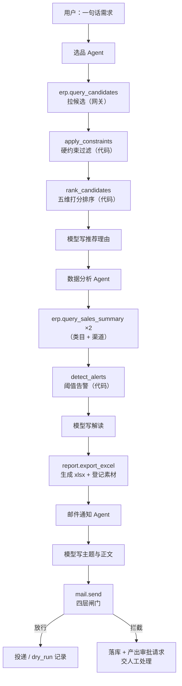
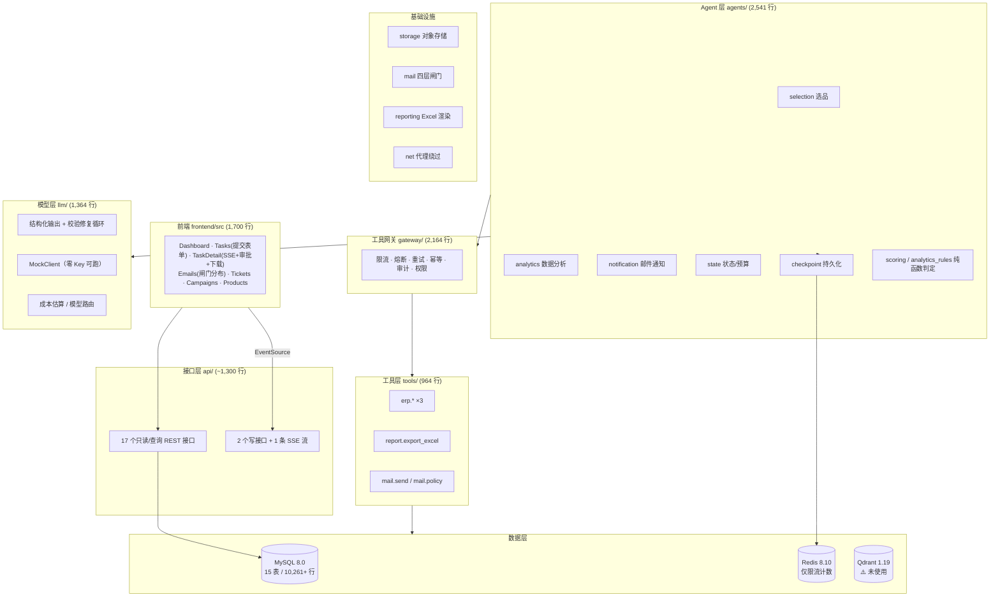

# 09 · 项目现状与功能清单

> 生成时间：2026-09-12（**W5 完成后已更新**，见 §0.2）
> 用途：让你核对"做到哪了、业务逻辑是什么、每块功能对应哪个文件、还缺什么"。
> **本文档只描述代码里真实存在的东西**，没写的功能一律标为"未完成"。
> 与 `docs/07-项目规划.md` 的偏差单独放在 §8 核对。

---

## 0. 一句话现状

**W5 已完成：前端全部接上。现在可以在界面上「交办一句话」→ 看 DAG 实时跑 → 点确认 → 下载报表，
全程不用碰命令行。**

链路是通的、可演示的：

```
界面填一句话 → POST /tasks → 模型拆 DAG → selection → analytics → ⏸ 停下等确认
   ↑                                                                    ↓
   └──── SSE 实时推事件（不用刷页面） ←──── 点「批准」→ 从断点跑完 → 产出 xlsx 可下载
```

### 0.1 W4 新增了什么（2026-09-12）

| 新增 | 文件 | 做什么 |
| --- | --- | --- |
| 任务规划 | `agents/planner.py` | 模型出 DAG + **代码校验计划合法性** + 关键词兜底 |
| 编排图 | `agents/orchestrator.py` | `StateGraph`：plan → hub 条件路由 → 各 Agent → 审批闸口 → finalize |
| 运行器 | `agents/runner.py` | 跑图 + 逐节点记账 + 区分"跑完了"与"停在闸口" |
| 任务落库 | `agents/recorder.py` | `tasks` / `task_events` / `agent_runs` 三张表**终于有真数据了** |
| 写接口 | `api/routers/tasks.py` | `POST /tasks`、`POST /tasks/{no}/approve`、`GET /tasks/{no}/stream`(SSE) |
| 测试 | `tests/test_orchestrator.py` | 51 项 |
| 演示 | `scripts/demo_orchestrator.py` | 端到端 + 展示落库结果 |

**关键改变**：三个 Agent 不再靠脚本顺序调用，执行顺序**完全由模型拆出的计划决定** ——
用户只说"出份报表"，图上就只跑 analytics 一步，不会白跑选品。

### 0.2 W5 新增了什么（2026-09-12）

| 新增 | 文件 | 做什么 |
| --- | --- | --- |
| 提交需求表单 | `frontend/src/pages/Tasks.tsx` | 多行输入 + 示例芯片 + Ctrl/⌘+Enter 提交 → 直接跳详情页 |
| **实时事件流** | `frontend/src/api.ts` `openTaskStream()` | 原生 `EventSource`，断线重连/`Last-Event-ID` 续传由浏览器接管 |
| 实时详情页 | `frontend/src/pages/TaskDetail.tsx` | DAG 按新 `steps` 形状渲染 + 节点状态由事件流推导 + 「实时更新中」标记 |
| **审批横幅** | 同上 | 显示 `action` / `reason` / `risk` + 审批人/理由输入 + 批准/驳回 |
| 产物下载 | 同上 | `result.artifacts` 里带 `url` / 大小，直接渲染下载按钮 |
| **邮件闸门页** | `frontend/src/pages/Emails.tsx` | 决策分布条 + 全部/仅被拦筛选 + 展开看拦截原因与正文 |
| 邮件接口 | `api/routers/business.py` | `GET /emails`、`GET /emails/stats` |
| 素材下载地址 | `api/schemas.py` | `AssetOut.download_url` computed_field，前端不用自己拼路径 |

**W5 修的 3 个真 bug（都是「后端手工测过、界面一用就崩」的类型）**：

| # | Bug | 根因 |
| --- | --- | --- |
| 1 | 刚提交完就跳到"请求失败：404"**死页面**，且任务真跑起来后**永远不会自己恢复** | `POST /tasks` 把活丢线程池就 return，任务行由后台线程插 → 接口返回时 id 还查不到 |
| 2 | 同一个事件对象在 REST 与 SSE 里字段名不同（`node`/`node_name`） | 归一化只做在一个路由里，而不是**唯一出口** |
| 3 | 任务状态是绿色"成功"，下面却挂个红框"失败原因" | `error_message` 有值 ≠ 任务失败（邮件被闸门拦住也写这个字段） |

依旧要如实说明两个"看起来做了、其实没做"的点：

| 现象 | 真实情况 |
| --- | --- |
| `.env` 配了 Qdrant，`/health` 探活正常 | **没有任何业务代码连它** —— 向量检索、RAG 一行都没写（按规划是 W7） |
| 任务列表里有 20 多条"完成"的任务 | 大部分是 seed 灌的**演示数据**；真任务号长这样：`T2609120…` / `ORCH-DEMO-…` |

---

## 1. 业务逻辑：这个系统在做什么

### 1.1 业务场景

一家服装电商的运营团队，把日常重复工作交给 AI 中台：

> 运营在界面上写一句自然语言需求，例如
> 「帮我选 3 款秋季女装，再出一份近 30 天的经营分析报表发给 ops@example.com」，
> 系统自动拆成若干步骤、调用真实数据算指标、生成 Excel 报表、发邮件通知，
> 全过程的每一步都可追踪、可干预、可审计。

### 1.2 三个 Agent 各自在干嘛

| Agent | 输入 | 做什么 | 输出 |
| --- | --- | --- | --- |
| **选品** | 自然语言需求 | 解析需求 → 拉候选 → 硬约束过滤 → 五维打分排序 → 写推荐理由 | `findings['selection']`：选中的 N 款 + 被挡掉的原因 |
| **数据分析** | （可选）上游选品结论 | 聚合销售数据 → **代码算告警** → 生成 xlsx → 模型写解读 | `findings['analytics']` + `Artifact(报表)` |
| **邮件通知** | 上游分析结论 + 报表素材 | 模型写主题正文 → 过四层闸门 → 投递或记录拦截 | `findings['notification']` + `email_messages` 记录 |

### 1.3 核心分工原则（贯穿三个 Agent）

这是整个项目最重要的设计决策，也是面试时最该讲的一条：

| 环节 | 谁做 | 为什么 |
| --- | --- | --- |
| 理解自然语言、写措辞 | **模型** | 这是它真正擅长的事 |
| 算数、判定、阈值比较 | **代码** | 让模型算数会得到不可复现且**静默错误**的结果 |
| 该不该做、能不能做 | **代码** | 白名单/预算/硬约束是策略，不是创作 |
| 上下文压缩 | **代码** | 上游结论压成摘要再传给下游，否则长链路必爆 |

**踩过的实证**：第一版把"退货率 > 30% 才算 critical"写在 prompt 里，
真实跑 `glm-4-flash` 时它给 14.69% 也标了 critical。**模型会忽略数值阈值** ——
所以现在 `severity` 字段直接从模型的 schema 里删掉了，严重程度只由
`agents/analytics_rules.py` 算。

### 1.4 一次任务的完整生命周期



> 注意：上图是**业务逻辑上的流程**。目前它是靠 `scripts/demo_pipeline.py`
> **顺序调用 + 手写状态合并**实现的，**不是 LangGraph 图**。见 §7.1。

---

## 2. 功能清单 → 代码映射

### 2.1 已完成功能总表

| # | 功能 | 状态 | 主要代码文件 |
| --- | --- | --- | --- |
| 1 | 15 张业务表 + 假数据生成 | ✅ | `db/models.py`(780) · `seed/__init__.py`(293) · `seed/generators.py`(1161) |
| 2 | 真实 MySQL / SQLite 双模接入 | ✅ | `config.py`(356) · `db/base.py`(190) · `db/cli.py`(144) |
| 3 | 工具网关（限流/熔断/重试/幂等/审计/权限） | ✅ | `gateway/core.py`(783) · `rate_limit.py`(245) · `circuit_breaker.py`(398) · `audit.py`(221) · `registry.py`(229) · `errors.py`(185) |
| 4 | 模型层（结构化输出/工具循环/路由/成本） | ✅ | `llm/client.py`(407) · `openai_compat.py`(220) · `mock.py`(475) · `pricing.py`(72) · `types.py`(122) |
| 5 | Agent 状态定义 + 预算控制 | ✅ | `agents/state.py`(387) |
| 6 | Checkpoint 持久化（Redis/SQLite/Memory） | ✅ **已被编排图使用** | `agents/checkpoint.py`(250) |
| 7 | 选品 Agent | ✅ | `agents/selection.py`(330) · `agents/scoring.py`(459) · `tools/erp.py`(331) |
| 8 | 数据分析 Agent | ✅ | `agents/analytics.py`(386) · `agents/analytics_rules.py`(230) · `reporting.py`(184) · `tools/report.py`(236) |
| 9 | 邮件通知 Agent + 四层闸门 | ✅ | `agents/notification.py`(405) · `mail/gate.py`(410) · `mail/sender.py`(250) · `tools/mail.py`(338) |
| 10 | 对象存储抽象（可切 MinIO） | ✅ | `storage.py`(163) |
| 11 | FastAPI 接口（19 个） | ✅ | `api/main.py` · `api/routers/business.py` · `api/routers/tasks.py` · `api/routers/system.py` · `api/schemas.py` |
| 12 | 本地服务绕过系统代理 | ✅ | `net.py`(133) |
| 13 | 前端 7 个页面 | ✅ **W5 已接上写接口与 SSE** | `frontend/src/pages/*.tsx` · `frontend/src/api.ts` |
| 14 | **总控编排 Agent（LangGraph 图）** | ✅ | `agents/orchestrator.py` · `agents/planner.py` · `agents/runner.py` |
| 15 | **HITL 人工确认闸口** | ✅ | `agents/orchestrator.py`（`interrupt()` + `Command(resume=)`） |
| 16 | **SSE 实时推送** | ✅ **前后端都通了** | `api/routers/tasks.py` · `frontend/src/api.ts` |
| 17 | **任务落库** | ✅ | `agents/recorder.py` |
| 18 | **界面提交任务 + 实时 DAG + 审批 + 下载** | ✅ W5 | `frontend/src/pages/Tasks.tsx` · `TaskDetail.tsx` |
| 19 | **邮件闸门可视化** | ✅ W5 | `frontend/src/pages/Emails.tsx` |
| 20 | **RAG / 向量检索** | ❌ | — |
| 21 | 其余 6 个 Agent | ❌ | — |

后端源码合计约 **14,000 行**（`platform/src/fashionops/`，不含测试）；前端约 **1,700 行**。

### 2.2 分层架构



### 2.3 逐文件说明

#### `agents/` —— Agent 层

| 文件 | 行数 | 职责 |
| --- | --- | --- |
| `state.py` | 387 | `TaskState` 定义、`RunContext`（**刻意不放进状态**，因为不可序列化）、预算控制、**`step_update()` 收口 reducer 语义差异** |
| `checkpoint.py` | 250 | Redis/SQLite/Memory 三级 checkpointer 工厂；`pending_nodes()` 判断中断停在哪 |
| `scoring.py` | 459 | 选品硬约束 + 五维打分（**纯函数、可复现**） |
| `selection.py` | 330 | 选品节点工厂 `make_selection_node(ctx)` |
| `analytics_rules.py` | 230 | **阈值告警判定**（纯代码，含"小样本不下结论"） |
| `analytics.py` | 386 | 数据分析节点工厂 |
| `notification.py` | 405 | 邮件通知节点工厂（含正则兜底提取收件人） |
| `planner.py` | 606 | W4：模型出 DAG + 代码校验 + 关键词兜底；**`normalize_dag()` 也在这里**（W5 从路由搬来） |
| `orchestrator.py` | 470 | W4：`StateGraph` 构图 + 条件路由 + `interrupt()` 闸口 + finalize |
| `runner.py` | 259 | W4：`TaskRunner.submit()/resume()/current()`；`RunOutcome` |
| `recorder.py` | 470 | W4：落 `tasks`/`task_events`/`agent_runs`；`read_events()` 供 SSE 与 REST 共用 |

> 约定：节点一律写成 **`make_xxx_node(ctx)` 工厂函数**，不在节点内部
> `get_context(config)` —— 依赖在构图时确定，单测可直接调用，也不依赖 LangGraph 的函数签名内省。

#### `gateway/` —— 工具网关（所有外部调用的收口）

| 文件 | 行数 | 职责 |
| --- | --- | --- |
| `core.py` | 783 | 主调用链：参数校验 → 权限 → 限流 → 熔断 → 幂等 → 重试 → 超时 → 审计 |
| `registry.py` | 229 | `ToolSpec` 声明 + 点号/`__` 名称转换（OpenAI function name 不允许点号） |
| `rate_limit.py` | 245 | 滑动窗口日志，Lua 脚本原子执行（**Redis 与内存两套实现**） |
| `circuit_breaker.py` | 398 | 三态熔断，半开态用 `SET NX` 抢一个探测名额 |
| `audit.py` | 221 | 递归脱敏 + 截断，三种 sink（内存/SQL/扇出） |
| `errors.py` | 185 | `ErrorCode` + `ToolError`（含 `hint`，让模型知道"为什么被拒、该怎么办"） |

**关键设计**：只读工具 fail-open、写工具 fail-closed。

#### `llm/` —— 模型层

| 文件 | 行数 | 职责 |
| --- | --- | --- |
| `client.py` | 407 | `structured_call()`（校验失败回喂**具体错误**重试）、`run_tool_loop()`、`ModelRouter`、`get_model_client()` |
| `openai_compat.py` | 220 | 兼容 OpenAI 协议的各家（智谱/DeepSeek/通义），base_url 自动推导 |
| `mock.py` | 475 | **schema 驱动的假数据生成**：读 `Field(ge=,le=)`、优先用声明的默认值 |
| `pricing.py` | 72 | token 价格表 + 成本估算 |

#### `tools/` —— 工具层（6 个工具）

| 工具 | 权限 | 只读 | 幂等 | 说明 |
| --- | --- | --- | --- | --- |
| `erp.query_candidates` | `erp:read` | ✅ | — | 候选商品（含库存/销量/竞品价） |
| `erp.query_inventory` | `erp:read` | ✅ | — | 按 SKU 查可用库存 |
| `erp.query_sales_summary` | `erp:read` | ✅ | — | 类目/日期/渠道聚合（GMV/退货率/客单价） |
| `report.export_excel` | `asset:write` | ❌ | ✅ | 渲染 xlsx → 落存储 → 登记素材 |
| `mail.policy` | `mail:send` | ✅ | — | 查看当前发信策略 |
| `mail.send` | `mail:send` | ❌ | ✅ | 过闸门后投递，**放行与被拦都落库** |

#### 其他基础设施

| 文件 | 行数 | 职责 |
| --- | --- | --- |
| `config.py` | 356 | 全部配置（`FASHIONOPS_` 前缀），44+ 字段，含邮件闸门与 SMTP |
| `storage.py` | 163 | `StorageBackend` 抽象 + 本地实现（路径逃逸防护 + 原子写入） |
| `reporting.py` | 184 | openpyxl 渲染（**中文按 2 字符宽算列宽**、数字格式、冻结首行） |
| `net.py` | 133 | 让本地服务绕过系统代理，**同时不破坏外网代理** |
| `cache.py` | 86 | Redis 连接与 DB 分库（db0 任务状态 / db1 限流 / db2 业务缓存） |

---

## 3. 数据层现状

### 3.1 组件

| 组件 | 版本 | 地址 | 用途 | 是否真被用 |
| --- | --- | --- | --- | --- |
| MySQL | 8.0.43 | `127.0.0.1:3306` | 业务数据 | ✅ 15 表 / 10,261+ 行 |
| Redis | 8.10.1 | `127.0.0.1:6379` | 限流计数 | ✅ 限流在用；**checkpoint 实际是 SQLite 降级**（本机 Redis 缺 RediSearch） |
| Qdrant | 1.19.1 | `127.0.0.1:6333` | 向量检索 | ❌ **装了但没代码用它** |

### 3.2 15 张表

| # | 表 | 用途 | 真实写入来源 |
| --- | --- | --- | --- |
| 1 | `products` | 商品 SPU | seed |
| 2 | `skus` | SKU（颜色/尺码） | seed |
| 3 | `inventory` | 库存流水 | seed |
| 4 | `orders` | 订单 | seed |
| 5 | `competitors` | 竞品价格 | seed |
| 6 | `bi_metrics` | 日度经营指标 | seed |
| 7 | `kb_articles` | 客服知识库（RAG 召回源） | seed |
| 8 | `tickets` | 客服工单 | seed |
| 9 | `tasks` | 任务主表 | seed + ✅ **真实写入**（W4 起，界面提交的每个任务） |
| 10 | `task_events` | 任务事件流（SSE 数据源） | seed + ✅ **真实写入** |
| 11 | `agent_runs` | 单次 Agent 执行记录 | seed + ✅ **真实写入**（编排节点不入表，见下） |
| 12 | `assets` | 素材（报表/图片/视频） | ✅ **真实写入**（`report.export_excel`） |
| 13 | `ad_campaigns` | 广告投放计划 | seed |
| 14 | `email_messages` | 邮件记录 | ✅ **真实写入**（`mail.send`，含被拦的） |
| 15 | `audit_logs` | 审计日志 | seed（网关审计目前走内存 sink） |

### 3.3 假数据里刻意埋的异常

这些是演示"Agent 真能发现问题"的素材：

| 异常 | 数量 |
| --- | --- |
| 库存告急 SKU（≤ 5 件） | 76 |
| 亏损广告计划（ROI < 1.0） | 3 |
| 转人工工单 | 14 |
| Agent 失败/超时运行 | 9 |
| 被闸门拦下的邮件 | 8 |

> 随机种子固定（`20260911`），所以 SQLite 和 MySQL 灌出来的数据**逐位一致**。

---

## 4. 接口清单（19 个）

### 4.1 写接口（W4 新增，会真的触发 Agent 跑任务）

| 方法 | 路径 | 说明 |
| --- | --- | --- |
| POST | `/api/v1/tasks` | 提交任务，**先把任务行落库再返回**，然后后台线程跑图 |
| POST | `/api/v1/tasks/{task_no}/approve` | 人工确认（批准 / 驳回），从断点继续 |
| GET | `/api/v1/tasks/{task_no}/stream` | **SSE 实时进度流**，支持 `Last-Event-ID` 断线续传 |

### 4.2 只读接口

| 方法 | 路径 | 说明 |
| --- | --- | --- |
| GET | `/health` | 三项依赖探活（MySQL/Redis/Qdrant），挂掉返回结构化诊断而非 500 |
| GET | `/api/v1/meta` | 运行时元信息（不含敏感配置） |
| GET | `/api/v1/summary` | 首页概览数字 |
| GET | `/api/v1/products` | 商品列表（支持类目/季节/状态/搜索/分页） |
| GET | `/api/v1/products/categories` | 类目与季节可选值 |
| GET | `/api/v1/inventory/low-stock` | 库存告急 SKU |
| GET | `/api/v1/tasks` | 任务列表（`dag` 已在 schema 层归一化） |
| GET | `/api/v1/tasks/{task_no}` | 任务详情（含 DAG、挂起状态、审批载荷、`is_running`） |
| GET | `/api/v1/tasks/{task_no}/events` | 任务事件流（支持 `since_seq` 增量拉取） |
| GET | `/api/v1/tickets` | 客服工单 |
| GET | `/api/v1/campaigns` | 广告计划（`only_losing=true` 只看亏损） |
| GET | `/api/v1/metrics/daily` | 日度经营指标 |
| GET | `/api/v1/assets` | 素材列表（含 `storage_path` 与 `download_url`） |
| GET | `/api/v1/assets/raw/{key}` | **下载素材原文件**（报表 URL 指向这里） |
| GET | `/api/v1/kb` | 客服知识库文章 |
| GET | `/api/v1/emails` | **W5：邮件记录**（含被闸门拦下的；`only_blocked=true` 只看被拦） |
| GET | `/api/v1/emails/stats` | **W5：闸门决策分布**（按 `gate_decision` 分组计数） |

**写操作全部走工具网关**（带限流/审计/权限），不像只读接口那样直连 Session ——
"绕过治理的入口"只要存在一个，治理就等于没有。

### 4.3 SSE 帧格式（前端解析时要看的）

```
id: 9
数据帧：  data: {"seq":9,"event_type":"approval_required","node_name":"approval_gate",...}

控制帧：  data: {"type":"done","status":"succeeded","seq":16}
          data: {"type":"task_error","detail":"任务 XXX 不存在"}
```

两个刻意的设计（都是为了不让前端"静默出错"）：

- **帧里不写 `event:` 名字** —— 事件类型已经在 `data.event_type` 里了，写两遍意味着
  前端要给每个类型各注册一个监听器，后端新增一种事件时前端会**静默漏掉**（不报错，只是不显示）。
  不具名事件全部落到 `EventSource.onmessage`，一个 handler 接住任意类型。
- **控制帧用 `type` 判别，不叫 `error`** —— `EventSource` 自带一个 `error` 事件（网络断了），
  同名的话一个 handler 会被两种完全不同的情况触发。

---

## 5. 前端现状（W5 已接完）

| 页面 | 路由 | 用了什么 | 数据来源 |
| --- | --- | --- | --- |
| Dashboard | `/dashboard` | **ECharts** 折线图 | seed 的 `bi_metrics` |
| Tasks | `/tasks` | 表格 + **提交需求表单**（示例芯片 / Ctrl·⌘+Enter） | **真实 `tasks`**（真任务 + seed 演示数据混在一起） |
| TaskDetail | `/tasks/:taskNo` | **React Flow** 画 DAG + **SSE 实时事件流** + 审批横幅 + 产物下载 | 真任务的 `tasks` / `task_events` |
| Emails | `/emails` | 决策分布条 + 筛选 + 展开行 | **真实 `email_messages`** |
| Tickets | `/tickets` | 表格 | seed 的 `tickets` |
| Campaigns | `/campaigns` | 表格 | seed 的 `ad_campaigns` |
| Products | `/products` | 表格 + 筛选 | seed 的 `products` |

- 技术栈：React 19 + Vite 7 + TS + React Router 7 + `@xyflow/react` 12 + ECharts 5
- 前端源码约 **1,700 行**；`npm run build`（`tsc --noEmit && vite build`）通过
- Vite 代理 `/api` → `127.0.0.1:8000`
- 开发端口：**默认 5173，但常被旧实例占着 → 会退到 5174**，实际端口看 `data/logs/web.out.log`

### 前端上的四个设计取舍

1. **审批做成常驻横幅，不是弹窗** —— 弹窗能被随手关掉，而"任务卡在等你点确认"这件事
   关掉后就没地方看了。横幅上必须显示 `action`（要干什么）和 `reason`（为什么要人点），
   否则用户只能盲批。
2. **用原生 `EventSource` 而不是 fetch + ReadableStream** —— 断线重连、`Last-Event-ID` 续传、
   保活全是它内建的，前端一行重连逻辑都不用写。代价：只能发 GET、不能带自定义头。
3. **素材 URL 由后端拼好**（`AssetOut.download_url`）—— 存储路径的拼法属于存储层细节，
   不该溢出到前端。
4. **`error_message` 按终态换措辞** —— `failed` →"任务失败"；`cancelled` →"任务已被人工取消"；
   其余→"任务已完成，但有需要留意的地方"。**字段有值 ≠ 任务失败**（邮件被闸门拦住也写这个字段）。

### 还差的

- ❌ 任务列表里**真任务和 seed 演示数据混在一起**，没有标记区分
- ❌ 没有素材/报表的**集中列表页**（下载入口只在任务详情的产物卡片上）
- ❌ 前端没有组件测试（只靠 `tsc` + 手工过一遍 UI 流程）
- ❌ 前端未装 eslint（仓库里也没有 eslint 配置）

---

## 6. 测试与质量

| 测试文件 | def 数 | 覆盖什么 |
| --- | --- | --- |
| `test_gateway.py` | 48 | 网关：限流/权限/熔断/幂等/审计/超时 |
| `test_llm.py` | 47 | 结构化输出修复循环、mock 生成器、成本估算 |
| **`test_orchestrator.py`** | **53** | **计划校验、失败传播、图端到端、HITL、任务落库、取消/失败事件区分** |
| `test_mail.py` | 42 | 闸门每个拒绝分支、SMTP 头部、通知节点端到端 |
| `test_analytics.py` | 32 | 聚合口径、告警规则、xlsx 可读性、节点端到端 |
| `test_selection.py` | 30 | 硬约束、五维打分、选品节点端到端 |
| `test_agents.py` | 24 | 状态 reducer 语义、预算、checkpoint |
| `test_gateway_redis.py` | 9 | **真 Redis** 版限流/熔断（无 Redis 自动跳过） |
| `test_api_mysql.py` | 6 (→19) | **真 MySQL** 跨方言接口测试（无 MySQL 自动跳过） |

**`pytest tests -q` → 303 passed**，`ruff check src tests scripts` 全绿，`npm run build` 通过。

### 测试策略上的三个关键点

1. **单元测试一律跑 SQLite 临时库**，不依赖外部服务 → CI 上不用装 MySQL/Redis 也能跑
2. 但这就带来一个盲区：**测试和开发用同一个库，就永远测不出方言差异**。
   所以单独有 `test_gateway_redis.py` 和 `test_api_mysql.py` 拿**真组件**跑，
   连不上自动 skip。这条经验是切 MySQL 时踩出来的（见 §7.3）。
3. **回归测试盖不住"真实客户端时序"** —— W5 那个「提交后立刻查 404」的 bug
   （§0.2 表格第 1 条）单测和手工 curl 都是绿的，只有浏览器点一下才暴露：
   人敲两条命令的间隔刚好够后台线程把行写进去。
   **有前端的功能，真实 UI 流程是必需验证，不是可选项。**

---

## 7. ⚠️ 还没做的

### 7.1 计划内未做（W6+）

| 任务 | 具体缺什么 | 影响 |
| --- | --- | --- |
| **清掉 seed 演示任务** | `tasks` 里真任务与 seed 数据混在一起，列表上是 20+ 条"完成"的任务 | 演示时分不清哪些是真跑出来的 |
| **素材管理页** | 下载入口只在任务详情的产物卡片上，没有集中的素材列表 | 找历史报表不方便 |
| **W6：图文 / 视频生成 Agent** | 零代码 | 阶段 2 的开始 |
| 网关审计落 `audit_logs` 表 | `SqlAuditSink` 写了但没接，现在走内存 sink | 重启即丢，面试时讲"全链路审计"会站不住 |

### 7.2 规划文档承诺但完全没动的

| 项 | 规划位置 | 状态 |
| --- | --- | --- |
| RAG（切分 + 向量 + BM25 + 重排） | §3 #9、W7 | ❌ 零代码。Qdrant 装了、`kb_articles` 表有 17 条数据，但没连线 |
| `VectorStore` 抽象接口 | §9.3 | ❌ 只在注释里被提到，**类不存在** |
| 其余 6 个 Agent（图文/视频/上架/广告/客服） | §8 | ❌ 零代码 |
| OTel 全链路追踪 | §3 #11、W10 | ❌ 配置项有，代码没有 |
| 评测集 + LLM-as-judge | §3 #12、W11 | ❌ 零代码 |
| Agent 记忆分层 | §3 #10 | ❌ `messages` 字段有，没有记忆逻辑 |
| 模型路由 | §3 #16 | ⚠️ `ModelRouter` 类写了，但**没有任何 Agent 用它** |
| SKILL.md 技能定义 | §3 #18 | ❌ 零代码 |
| MCP 协议暴露 | §3 #13 | ❌ `mcp-servers/` 原地未动（符合规划 §10 的"保留不动"） |

### 7.3 已知技术债

| # | 问题 | 严重度 | 说明 |
| --- | --- | --- | --- |
| 1 | `agents/__init__.py` 只导出了 `selection`，没导出 `analytics` / `notification` | 低 | 导入路径不一致 |
| 2 | 网关审计目前用**内存 sink**，重启即丢 | 中 | `SqlAuditSink` 写了但没接；应写入 `audit_logs` 表 |
| 3 | 端到端链路约 60~90 s | 中 | 主要是 `glm-4-flash` 延迟（plan 15s / 每个 Agent 20~40s）。优化方向是模型路由，不是改代码 |
| 4 | `docs/07` 的项目规划文档**停畩在阶段 0** | 低 | 没同步阶段 1 的实际进展 |
| 5 | MySQL root 密码是弱密码 | **高** | `123456`，且已出现在会话记录里。**建议尽快换掉** |
| 6 | Docker 仍未安装 | 低 | 架构已留好口子，不阻塞功能 |
| 7 | 前端无组件测试 | 中 | 只靠 `tsc` + 手工走 UI 流程。W5 已经证明"后端全绿但界面一用就崩"是真实存在的 |
| 8 | `tasks` 表真数据与 seed 数据混存 | 低 | 演示时会误导，清库或加标记即可 |

---

## 8. 与规划文档的偏差核对（防跑偏）

| 规划怎么说 | 实际怎么做 | 是否跑偏 |
| --- | --- | --- |
| §3 要求 18 项热门技术全做 | 目前完成网关/结构化输出/多 Agent/可插拔依赖 4 项 | ⚠️ 进度慢于"全做"，但符合 §3 末尾"P0+P1 共 12 项优先"的建议 |
| §6/§9.3 建议零 Docker 替代路线（SQLite + Chroma） | **§10.1 已修订为"本地真组件"**，实际按 §10.1 执行（真 MySQL + Redis + Qdrant） | ✅ 符合**最新**决策 |
| §4 阶段 0：14 张表 | 15 张（多了 `audit_logs`） | ✅ 合理扩展 |
| §4 阶段 1 选 4 个 Agent | 已完成 3 个，第 4 个（总控编排）已完成 | ✅ 符合 |
| §11 W1–W3 交付物 | 全部完成，W3 的三个 Agent 已落地 | ✅ 略快于计划 |
| §11 W4 验收「一句话跑通 3 Agent 链路」 | **已达成**，且是从 HTTP 接口提交的，含 HITL 中断与断点恢复 | ✅ 超额完成 |
| §11 W5 前端 | **已完成**：提交表单 / SSE 实时流 / 审批横幅 / 产物下载 / 邮件闸门页 | ✅ 完成 |
| §10 `mcp-servers/` 保留原地不动 | 确实一行未改 | ✅ 符合 |
| §5/§10 前端全栈由我做，6 个页面 | 7 个页面（多了邮件闸门页） | ✅ 合理扩展 |

### 结论

**方向没跑偏，W1–W5 全部兑现，且交付物比规划写的更完整。**

两个需要你知情的点：

1. **Qdrant 仍然闲置**。装好了、`.env` 配了、`/health` 也探活了，**但没有任何代码连它**。
   按规划它是 W7（客服 RAG）才用的 —— 所以"现在闲置"符合排期。
   如果你想早点把它用起来（比如给 `kb_articles` 建索引做个演示），可以提前到 W6。
2. **邮件发不出去是故意的**。当前 `MAIL_ENABLED=false` + `MAIL_DRY_RUN=true` + 白名单空 ——
   所以每次通知步骤都会"被闸门拦下"，任务显示"成功但有需要留意的地方"。
   这是 fail-closed 设计的正常表现，不是 bug。要真发需同时满足四个条件（见 `docs/06`）。

---

## 9. 怎么自己验证（不用看代码）

### 9.1 最快的一条路：直接在界面上跑一个真任务

1. 确认后端在跑：开 `http://127.0.0.1:8000/health` 应返回 `"status":"ok"`
2. 开前端（端口以 `data/logs/web.out.log` 里打的那行为准，通常是 5173 或 5174）
3. 进 **任务工作台** → 点一个示例芯片 → 提交
4. 会自动跳到详情页，应该看到：
   - 右上角 **绿点 + "实时更新中"**
   - 事件流**自己一条一条长出来**（不用刷页面）
   - 约 60~90 秒后弹出黄色**审批横幅**
5. 点「✓ 批准并继续」→ 几秒后状态变**成功**，多出一张「产出」卡片
6. 点「下载」→ 应拿到一个真 `.xlsx`（打开能看到经营分析报表）
7. 进 **邮件闸门** → 能看到刚才那封被拦下的邮件 + 闸门决策分布

> 看不到审批横幅？当前策略下（总开关关）任务会显示「成功但有需要留意的地方」，
> 这是 fail-closed 的正常表现 —— 点开邮件闸门页就能看到为什么被拦。

### 9.2 命令行

```powershell
cd "c:\Users\Administrator\Desktop\Work agent\platform"

# 数据层
.venv\Scripts\fashionops-db.exe info        # MySQL + 15 张表行数

# 接口：打开 http://127.0.0.1:8000/docs（19 个接口）

# 单跑某个 Agent
.venv\Scripts\python.exe scripts\demo_selection.py --mock
.venv\Scripts\python.exe scripts\demo_analytics.py --mock

# 编排端到端（不污染开发库）
.venv\Scripts\python.exe scripts\demo_orchestrator.py --tmp --mock --auto-approve
.venv\Scripts\python.exe scripts\demo_orchestrator.py --mock --reject        # 测驳回

# 质量
.venv\Scripts\python.exe -m pytest tests -q      # 应 303 passed
.venv\Scripts\ruff.exe check src tests scripts   # 应全绿
cd frontend; npm run build                       # tsc + vite build
```

**最值得看的两个演示**：

1. `scripts/demo_orchestrator.py` —— 一句话 → 拆 DAG → 中途停下 → 批准 → 跑完 → 落库，
   末尾会打印 `tasks` / `task_events` / `agent_runs` 三张表的真实内容。
2. **界面上的实时事件流** —— 提交后不刷页面，事件自己长出来。
   这是 SSE + 断点恢复在同一个页面上同时可见的地方。

---

## 10. 下一步（建议顺序）

| 顺序 | 任务 | 产出 |
| --- | --- | --- |
| 1 | **清掉 seed 演示任务** | 列表只剩真任务，演示时不会让人误以为都是真跑的 |
| 2 | **网关审计落 `audit_logs` 表** | 现在重启即丢，"全链路审计"讲不硬 |
| 3 | MySQL root 密码轮换 | 安全收尾 |
| 4 | **W6：图文生成 + 视频生成 Agent + 素材管理页** | 进入阶段 2，也是 Qdrant 之外的下一个新技术点 |
| 5 | W7：客服 Agent（RAG：切分 + 向量 + BM25 + 重排） | Qdrant 到这时才真的启用 |

阶段 1（规划链）已经真正闭环，**可以拿去做演示了**。
剩下的 1~3 项都是收尾，不新增能力。
