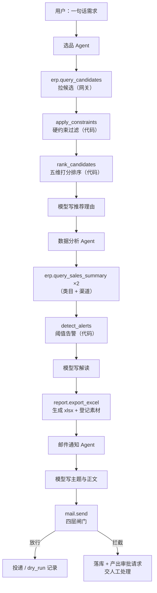
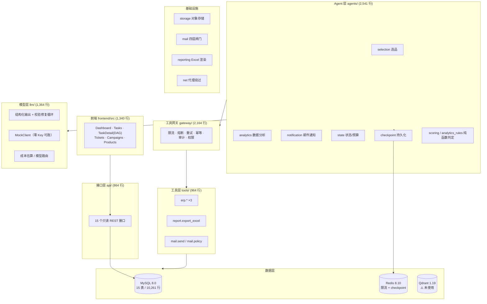

# 09 · 项目现状与功能清单

> 生成时间：2026-09-12（**W4 完成后已更新**，见 §0.1）
> 用途：让你核对"做到哪了、业务逻辑是什么、每块功能对应哪个文件、还缺什么"。
> **本文档只描述代码里真实存在的东西**，没写的功能一律标为"未完成"。
> 与 `docs/07-项目规划.md` 的偏差单独放在 §8 核对。

---

## 0. 一句话现状

**W4 已完成：总控编排 Agent（LangGraph StateGraph）+ HITL 人工确认 + 任务落库 + 写接口 + SSE 全部到位。
“一句话需求”现在可以从 HTTP 接口提交，自动拆解成 DAG、逐步执行、中途停下来等人工确认、确认后从断点继续跑完，
全过程写进数据库并实时推给前端。**

### 0.1 W4 新增了什么（2026-09-12）

| 新增 | 文件 | 做什么 |
| --- | --- | --- |
| 任务规划 | `agents/planner.py` | 模型出 DAG + **代码校验计划合法性** + 关键词兜底 |
| 编排图 | `agents/orchestrator.py` | `StateGraph`：plan → hub 条件路由 → 各 Agent → 审批闸口 → finalize |
| 运行器 | `agents/runner.py` | 跑图 + 逐节点记账 + 区分"跑完了"与"停在闸口" |
| 任务落库 | `agents/recorder.py` | `tasks` / `task_events` / `agent_runs` 三张表**终于有真数据了** |
| 写接口 | `api/routers/tasks.py` | `POST /tasks`、`POST /tasks/{no}/approve`、`GET /tasks/{no}/stream`(SSE) |
| 测试 | `tests/test_orchestrator.py` | 51 项 |
| 演示 | `scripts/demo_orchestrator.py` | 端到端 + 展示落库结果 |

**关键改变**：三个 Agent 不再靠脚本顺序调用，执行顺序**完全由模型拆出的计划决定** ——
用户只说"出份报表"，图上就只跑 analytics 一步，不会白跑选品。

依旧要如实说明两个"看起来做了、其实没做"的点：

| 现象 | 真实情况 |
| --- | --- |
| `.env` 配了 Qdrant，`/health` 探活正常 | **没有任何业务代码连它** —— 向量检索、RAG 一行都没写（按规划是 W7） |
| 前端有任务页、DAG 图 | 页面还没接新的写接口，**现在数据里既有真任务也有 seed 假任务** |

---

## 1. 业务逻辑：这个系统在做什么

### 1.1 业务场景

一家服装电商的运营团队，把日常重复工作交给 AI 中台：

> 运营在界面上写一句自然语言需求，例如
> 「帮我选 3 款秋季女装，再出一份近 30 天的经营分析报表发给 ops@example.com」，
> 系统自动拆成若干步骤、调用真实数据算指标、生成 Excel 报表、发邮件通知，
> 全过程的每一步都可追踪、可干预、可审计。

### 1.2 三个 Agent 各自在干嘛

| Agent | 输入 | 做什么 | 输出 |
| --- | --- | --- | --- |
| **选品** | 自然语言需求 | 解析需求 → 拉候选 → 硬约束过滤 → 五维打分排序 → 写推荐理由 | `findings['selection']`：选中的 N 款 + 被挡掉的原因 |
| **数据分析** | （可选）上游选品结论 | 聚合销售数据 → **代码算告警** → 生成 xlsx → 模型写解读 | `findings['analytics']` + `Artifact(报表)` |
| **邮件通知** | 上游分析结论 + 报表素材 | 模型写主题正文 → 过四层闸门 → 投递或记录拦截 | `findings['notification']` + `email_messages` 记录 |

### 1.3 核心分工原则（贯穿三个 Agent）

这是整个项目最重要的设计决策，也是面试时最该讲的一条：

| 环节 | 谁做 | 为什么 |
| --- | --- | --- |
| 理解自然语言、写措辞 | **模型** | 这是它真正擅长的事 |
| 算数、判定、阈值比较 | **代码** | 让模型算数会得到不可复现且**静默错误**的结果 |
| 该不该做、能不能做 | **代码** | 白名单/预算/硬约束是策略，不是创作 |
| 上下文压缩 | **代码** | 上游结论压成摘要再传给下游，否则长链路必爆 |

**踩过的实证**：第一版把"退货率 > 30% 才算 critical"写在 prompt 里，
真实跑 `glm-4-flash` 时它给 14.69% 也标了 critical。**模型会忽略数值阈值** ——
所以现在 `severity` 字段直接从模型的 schema 里删掉了，严重程度只由
`agents/analytics_rules.py` 算。

### 1.4 一次任务的完整生命周期



> 注意：上图是**业务逻辑上的流程**。目前它是靠 `scripts/demo_pipeline.py`
> **顺序调用 + 手写状态合并**实现的，**不是 LangGraph 图**。见 §7.1。

---

## 2. 功能清单 → 代码映射

### 2.1 已完成功能总表

| # | 功能 | 状态 | 主要代码文件 |
| --- | --- | --- | --- |
| 1 | 15 张业务表 + 假数据生成 | ✅ | `db/models.py`(780) · `seed/__init__.py`(293) · `seed/generators.py`(1161) |
| 2 | 真实 MySQL / SQLite 双模接入 | ✅ | `config.py`(356) · `db/base.py`(190) · `db/cli.py`(144) |
| 3 | 工具网关（限流/熔断/重试/幂等/审计/权限） | ✅ | `gateway/core.py`(783) · `rate_limit.py`(245) · `circuit_breaker.py`(398) · `audit.py`(221) · `registry.py`(229) · `errors.py`(185) |
| 4 | 模型层（结构化输出/工具循环/路由/成本） | ✅ | `llm/client.py`(407) · `openai_compat.py`(220) · `mock.py`(475) · `pricing.py`(72) · `types.py`(122) |
| 5 | Agent 状态定义 + 预算控制 | ✅ | `agents/state.py`(387) |
| 6 | Checkpoint 持久化（Redis/SQLite/Memory） | ✅ **已被编排图使用** | `agents/checkpoint.py`(250) |
| 7 | 选品 Agent | ✅ | `agents/selection.py`(330) · `agents/scoring.py`(459) · `tools/erp.py`(331) |
| 8 | 数据分析 Agent | ✅ | `agents/analytics.py`(386) · `agents/analytics_rules.py`(230) · `reporting.py`(184) · `tools/report.py`(236) |
| 9 | 邮件通知 Agent + 四层闸门 | ✅ | `agents/notification.py`(405) · `mail/gate.py`(410) · `mail/sender.py`(250) · `tools/mail.py`(338) |
| 10 | 对象存储抽象（可切 MinIO） | ✅ | `storage.py`(163) |
| 11 | FastAPI 只读接口（15 个） | ✅ | `api/main.py`(128) · `api/routers/business.py`(339) · `api/routers/system.py`(191) · `api/schemas.py`(193) |
| 12 | 本地服务绕过系统代理 | ✅ | `net.py`(133) |
| 13 | 前端 6 个页面 | ✅ 只读展示（**还没接写接口**） | `frontend/src/pages/*.tsx` |
| 14 | **总控编排 Agent（LangGraph 图）** | ✅ | `agents/orchestrator.py` · `agents/planner.py` · `agents/runner.py` |
| 15 | **HITL 人工确认闸口** | ✅ | `agents/orchestrator.py`（`interrupt()` + `Command(resume=)`） |
| 16 | **SSE 实时推送** | ✅ 后端就绪，前端未接 | `api/routers/tasks.py` |
| 17 | **任务落库** | ✅ | `agents/recorder.py` |
| 18 | **RAG / 向量检索** | ❌ | — |
| 19 | 其余 6 个 Agent | ❌ | — |

后端源码合计 **12,140 行**（`platform/src/fashionops/`，不含测试）。

### 2.2 分层架构



### 2.3 逐文件说明

#### `agents/` —— Agent 层

| 文件 | 行数 | 职责 |
| --- | --- | --- |
| `state.py` | 387 | `TaskState` 定义、`RunContext`（**刻意不放进状态**，因为不可序列化）、预算控制、**`step_update()` 收口 reducer 语义差异** |
| `checkpoint.py` | 250 | Redis/SQLite/Memory 三级 checkpointer 工厂；`pending_nodes()` 判断中断停在哪 |
| `scoring.py` | 459 | 选品硬约束 + 五维打分（**纯函数、可复现**） |
| `selection.py` | 330 | 选品节点工厂 `make_selection_node(ctx)` |
| `analytics_rules.py` | 230 | **阈值告警判定**（纯代码，含"小样本不下结论"） |
| `analytics.py` | 386 | 数据分析节点工厂 |
| `notification.py` | 405 | 邮件通知节点工厂（含正则兜底提取收件人） |

> 约定：节点一律写成 **`make_xxx_node(ctx)` 工厂函数**，不在节点内部
> `get_context(config)` —— 依赖在构图时确定，单测可直接调用，也不依赖 LangGraph 的函数签名内省。

#### `gateway/` —— 工具网关（所有外部调用的收口）

| 文件 | 行数 | 职责 |
| --- | --- | --- |
| `core.py` | 783 | 主调用链：参数校验 → 权限 → 限流 → 熔断 → 幂等 → 重试 → 超时 → 审计 |
| `registry.py` | 229 | `ToolSpec` 声明 + 点号/`__` 名称转换（OpenAI function name 不允许点号） |
| `rate_limit.py` | 245 | 滑动窗口日志，Lua 脚本原子执行（**Redis 与内存两套实现**） |
| `circuit_breaker.py` | 398 | 三态熔断，半开态用 `SET NX` 抢一个探测名额 |
| `audit.py` | 221 | 递归脱敏 + 截断，三种 sink（内存/SQL/扇出） |
| `errors.py` | 185 | `ErrorCode` + `ToolError`（含 `hint`，让模型知道"为什么被拒、该怎么办"） |

**关键设计**：只读工具 fail-open、写工具 fail-closed。

#### `llm/` —— 模型层

| 文件 | 行数 | 职责 |
| --- | --- | --- |
| `client.py` | 407 | `structured_call()`（校验失败回喂**具体错误**重试）、`run_tool_loop()`、`ModelRouter`、`get_model_client()` |
| `openai_compat.py` | 220 | 兼容 OpenAI 协议的各家（智谱/DeepSeek/通义），base_url 自动推导 |
| `mock.py` | 475 | **schema 驱动的假数据生成**：读 `Field(ge=,le=)`、优先用声明的默认值 |
| `pricing.py` | 72 | token 价格表 + 成本估算 |

#### `tools/` —— 工具层（6 个工具）

| 工具 | 权限 | 只读 | 幂等 | 说明 |
| --- | --- | --- | --- | --- |
| `erp.query_candidates` | `erp:read` | ✅ | — | 候选商品（含库存/销量/竞品价） |
| `erp.query_inventory` | `erp:read` | ✅ | — | 按 SKU 查可用库存 |
| `erp.query_sales_summary` | `erp:read` | ✅ | — | 类目/日期/渠道聚合（GMV/退货率/客单价） |
| `report.export_excel` | `asset:write` | ❌ | ✅ | 渲染 xlsx → 落存储 → 登记素材 |
| `mail.policy` | `mail:send` | ✅ | — | 查看当前发信策略 |
| `mail.send` | `mail:send` | ❌ | ✅ | 过闸门后投递，**放行与被拦都落库** |

#### 其他基础设施

| 文件 | 行数 | 职责 |
| --- | --- | --- |
| `config.py` | 356 | 全部配置（`FASHIONOPS_` 前缀），44+ 字段，含邮件闸门与 SMTP |
| `storage.py` | 163 | `StorageBackend` 抽象 + 本地实现（路径逃逸防护 + 原子写入） |
| `reporting.py` | 184 | openpyxl 渲染（**中文按 2 字符宽算列宽**、数字格式、冻结首行） |
| `net.py` | 133 | 让本地服务绕过系统代理，**同时不破坏外网代理** |
| `cache.py` | 86 | Redis 连接与 DB 分库（db0 任务状态 / db1 限流 / db2 业务缓存） |

---

## 3. 数据层现状

### 3.1 组件

| 组件 | 版本 | 地址 | 用途 | 是否真被用 |
| --- | --- | --- | --- | --- |
| MySQL | 8.0.43 | `127.0.0.1:3306` | 业务数据 | ✅ 15 表 / 10,261 行 |
| Redis | 8.10.1 | `127.0.0.1:6379` | 限流计数 + checkpoint | ✅ 限流在用；checkpoint 未接 |
| Qdrant | 1.19.1 | `127.0.0.1:6333` | 向量检索 | ❌ **装了但没代码用它** |

### 3.2 15 张表

| # | 表 | 用途 | 真实写入来源 |
| --- | --- | --- | --- |
| 1 | `products` | 商品 SPU | seed |
| 2 | `skus` | SKU（颜色/尺码） | seed |
| 3 | `inventory` | 库存流水 | seed |
| 4 | `orders` | 订单 | seed |
| 5 | `competitors` | 竞品价格 | seed |
| 6 | `bi_metrics` | 日度经营指标 | seed |
| 7 | `kb_articles` | 客服知识库（RAG 召回源） | seed |
| 8 | `tickets` | 客服工单 | seed |
| 9 | `tasks` | 任务主表 | ⚠️ **只有 seed**，真实运行不写 |
| 10 | `task_events` | 任务事件流（SSE 数据源） | ⚠️ **只有 seed** |
| 11 | `agent_runs` | 单次 Agent 执行记录 | ⚠️ **只有 seed** |
| 12 | `assets` | 素材（报表/图片/视频） | ✅ **真实写入**（`report.export_excel`） |
| 13 | `ad_campaigns` | 广告投放计划 | seed |
| 14 | `email_messages` | 邮件记录 | ✅ **真实写入**（`mail.send`，含被拦的） |
| 15 | `audit_logs` | 审计日志 | seed（网关审计目前走内存 sink） |

### 3.3 假数据里刻意埋的异常

这些是演示"Agent 真能发现问题"的素材：

| 异常 | 数量 |
| --- | --- |
| 库存告急 SKU（≤ 5 件） | 76 |
| 亏损广告计划（ROI < 1.0） | 3 |
| 转人工工单 | 14 |
| Agent 失败/超时运行 | 9 |
| 被闸门拦下的邮件 | 8 |

> 随机种子固定（`20260911`），所以 SQLite 和 MySQL 灌出来的数据**逐位一致**。

---

## 4. 接口清单（17 个）

### 4.1 写接口（W4 新增，会真的触发 Agent 跑任务）

| 方法 | 路径 | 说明 |
| --- | --- | --- |
| POST | `/api/v1/tasks` | 提交任务，立刻返回 `task_no`，后台线程跑图 |
| POST | `/api/v1/tasks/{task_no}/approve` | 人工确认（批准 / 驳回），从断点继续 |
| GET | `/api/v1/tasks/{task_no}/stream` | **SSE 实时进度流**，支持 `Last-Event-ID` 断线续传 |

### 4.2 只读接口

| 方法 | 路径 | 说明 |
| --- | --- | --- |
| GET | `/health` | 三项依赖探活（MySQL/Redis/Qdrant），挂掉返回结构化诊断而非 500 |
| GET | `/api/v1/meta` | 运行时元信息（不含敏感配置） |
| GET | `/api/v1/summary` | 首页概览数字 |
| GET | `/api/v1/products` | 商品列表（支持类目/季节/状态/搜索/分页） |
| GET | `/api/v1/products/categories` | 类目与季节可选值 |
| GET | `/api/v1/inventory/low-stock` | 库存告急 SKU |
| GET | `/api/v1/tasks` | 任务列表 |
| GET | `/api/v1/tasks/{task_no}` | 任务详情（含 DAG 定义） |
| GET | `/api/v1/tasks/{task_no}/events` | 任务事件流（支持 `since_seq` 增量拉取） |
| GET | `/api/v1/tickets` | 客服工单 |
| GET | `/api/v1/campaigns` | 广告计划（`only_losing=true` 只看亏损） |
| GET | `/api/v1/metrics/daily` | 日度经营指标 |
| GET | `/api/v1/assets` | 素材列表 |
| GET | `/api/v1/assets/raw/{key}` | **下载素材原文件**（报表 URL 指向这里） |
| GET | `/api/v1/kb` | 客服知识库文章 |

**写操作全部走工具网关**（带限流/审计/权限），不像只读接口那样直连 Session ——
"绕过治理的入口"只要存在一个，治理就等于没有。

---

## 5. 前端现状

| 页面 | 路由 | 用了什么 | 数据来源 |
| --- | --- | --- | --- |
| Dashboard | `/dashboard` | **ECharts** 折线图 | seed 的 `bi_metrics` |
| Tasks | `/tasks` | 表格 | seed 的 `tasks` |
| TaskDetail | `/tasks/:taskNo` | **React Flow** 画 DAG | seed 的 `tasks` + `task_events` |
| Tickets | `/tickets` | 表格 | seed 的 `tickets` |
| Campaigns | `/campaigns` | 表格 | seed 的 `ad_campaigns` |
| Products | `/products` | 表格 + 筛选 | seed 的 `products` |

- 技术栈：React 19 + Vite 7 + TS + React Router 7 + `@xyflow/react` 12 + ECharts 5
- 前端源码约 **1,340 行**
- Vite 代理 `/api` → `127.0.0.1:8000`

**缺口**：
- ❌ 没有 SSE（`EventSource` 一次都没出现）—— DAG 状态不会实时刷新，得手动刷页面
- ❌ 没有"提交任务"的入口（因为没有写接口）
- ❌ 没有"被拦截邮件"列表 —— 而这是闸门设计最该展示的东西
- ❌ 没有素材/报表下载入口（后端接口已就绪，前端没接）

---

## 6. 测试与质量

| 测试文件 | def 数 | 覆盖什么 |
| --- | --- | --- |
| `test_gateway.py` | 48 | 网关：限流/权限/熔断/幂等/审计/超时 |
| `test_llm.py` | 47 | 结构化输出修复循环、mock 生成器、成本估算 |
| **`test_orchestrator.py`** | **51** | **计划校验、失败传播、图端到端、HITL、任务落库** |
| `test_mail.py` | 42 | 闸门每个拒绝分支、SMTP 头部、通知节点端到端 |
| `test_analytics.py` | 32 | 聚合口径、告警规则、xlsx 可读性、节点端到端 |
| `test_selection.py` | 30 | 硬约束、五维打分、选品节点端到端 |
| `test_agents.py` | 24 | 状态 reducer 语义、预算、checkpoint |
| `test_gateway_redis.py` | 9 | **真 Redis** 版限流/熔断（无 Redis 自动跳过） |
| `test_api_mysql.py` | 6 (→19) | **真 MySQL** 跨方言接口测试（无 MySQL 自动跳过） |

**`pytest tests -q` → 301 passed**，`ruff check src tests scripts` 全绿。

### 测试策略上的两个关键点

1. **单元测试一律跑 SQLite 临时库**，不依赖外部服务 → CI 上不用装 MySQL/Redis 也能跑
2. 但这就带来一个盲区：**测试和开发用同一个库，就永远测不出方言差异**。
   所以单独有 `test_gateway_redis.py` 和 `test_api_mysql.py` 拿**真组件**跑，
   连不上自动 skip。这条经验是切 MySQL 时踩出来的（见 §7.3）。

---

## 7. ⚠️ 还没做的

### 7.1 计划内未做（W5）

| 任务 | 具体缺什么 | 影响 |
| --- | --- | --- |
| **前端接写接口** | 页面没有"提交任务"输入框，方法没调 `POST /tasks`，SSE 也没连 `EventSource` | 后端全部就绪，但用户从界面触发不了任务 |
| **前端任务列表混淆** | 现在 `tasks` 表里既有 seed 灌的假任务、也有真跑的任务 | 需要区分（比如加个标记或清掉假数据） |
| **被拦截邮件列表** | 后台与数据都有，前端没页面 | 闸门设计的价值展示不出来 |
| **素材/报表下载入口** | 接口已就绪 | 用户拿不到报表 |

### 7.2 规划文档承诺但完全没动的

| 项 | 规划位置 | 状态 |
| --- | --- | --- |
| RAG（切分 + 向量 + BM25 + 重排） | §3 #9、W7 | ❌ 零代码。Qdrant 装了、`kb_articles` 表有 17 条数据，但没连线 |
| `VectorStore` 抽象接口 | §9.3 | ❌ 只在注释里被提到，**类不存在** |
| 其余 6 个 Agent（图文/视频/上架/广告/客服） | §8 | ❌ 零代码 |
| OTel 全链路追踪 | §3 #11、W10 | ❌ 配置项有，代码没有 |
| 评测集 + LLM-as-judge | §3 #12、W11 | ❌ 零代码 |
| Agent 记忆分层 | §3 #10 | ❌ `messages` 字段有，没有记忆逻辑 |
| 模型路由 | §3 #16 | ⚠️ `ModelRouter` 类写了，但**没有任何 Agent 用它** |
| SKILL.md 技能定义 | §3 #18 | ❌ 零代码 |
| MCP 协议暴露 | §3 #13 | ❌ `mcp-servers/` 原地未动（符合规划 §10 的"保留不动"） |

### 7.3 已知技术债

| # | 问题 | 严重度 | 说明 |
| --- | --- | --- | --- |
| 1 | `agents/__init__.py` 只导出了 `selection`，没导出 `analytics` / `notification` | 低 | 导入路径不一致 |
| 2 | 网关审计目前用**内存 sink**，重启即丢 | 中 | `SqlAuditSink` 写了但没接；应写入 `audit_logs` 表 |
| 3 | 端到端链路约 70 s | 中 | 主要是 `glm-4-flash` 延迟。优化方向是模型路由，不是改代码 |
| 4 | `docs/07` 的项目规划文档**停留在阶段 0** | 低 | 没同步阶段 1 的实际进展 |
| 5 | MySQL root 密码是弱密码 | **高** | `123456`，且已出现在会话记录里。**建议尽快换掉** |
| 6 | Docker 仍未安装 | 低 | 架构已留好口子，不阻塞功能 |

---

## 8. 与规划文档的偏差核对（防跑偏）

| 规划怎么说 | 实际怎么做 | 是否跑偏 |
| --- | --- | --- |
| §3 要求 18 项热门技术全做 | 目前完成网关/结构化输出/多 Agent/可插拔依赖 4 项 | ⚠️ 进度慢于"全做"，但符合 §3 末尾"P0+P1 共 12 项优先"的建议 |
| §6/§9.3 建议零 Docker 替代路线（SQLite + Chroma） | **§10.1 已修订为"本地真组件"**，实际按 §10.1 执行（真 MySQL + Redis + Qdrant） | ✅ 符合**最新**决策 |
| §4 阶段 0：14 张表 | 15 张（多了 `audit_logs`） | ✅ 合理扩展 |
| §4 阶段 1 选 4 个 Agent | 已完成 3 个，第 4 个（总控编排）在进行中 | ✅ 符合 |
| §11 W1–W3 交付物 | 全部完成，W3 的三个 Agent 已落地 | ✅ 略快于计划 |
| §11 W4 验收「一句话跑通 3 Agent 链路」 | **已达成**，且是从 HTTP 接口提交的，含 HITL 中断与断点恢复 | ✅ 超额完成 |
| §11 W5 前端 | 未开始（后端已就绪） | ⏭ 下一步 |
| §10 `mcp-servers/` 保留原地不动 | 确实一行未改 | ✅ 符合 |
| §5/§10 前端全栈由我做，6 个页面 | 6 个页面都在 | ✅ 符合（但只读） |

### 结论

**没有跑偏方向，但有一个需要你确认的点：**

Qdrant 装好了、`.env` 配了、`/health` 也探活了，**但没有任何代码连它**。
按规划它是 W7（客服 RAG）才用的 —— 所以"现在闲置"是符合排期的，
但如果你希望早点把它用起来（比如给 `kb_articles` 建索引做演示），
可以把它提到 W4 前面，我需要你拍板。

---

## 9. 怎么自己验证（不用看代码）

```powershell
# 1. 数据层
cd "c:\Users\Administrator\Desktop\Work agent\platform"
.venv\Scripts\fashionops-db.exe info        # 应显示 MySQL + 15 张表行数

# 2. 接口（API 已在 8000 端口后台运行）
#    打开 http://127.0.0.1:8000/docs 看 15 个接口
#    打开 http://127.0.0.1:8000/health 看三项依赖

# 3. 前端
#    打开 http://localhost:5173/products

# 4. 单跑某个 Agent
.venv\Scripts\python.exe scripts\demo_selection.py --mock
.venv\Scripts\python.exe scripts\demo_analytics.py --mock

# 5. 三 Agent 端到端（用真实智谱模型）
.venv\Scripts\python.exe scripts\demo_pipeline.py

# 6. 质量
.venv\Scripts\python.exe -m pytest tests -q      # 应 249 passed
.venv\Scripts\ruff.exe check src tests scripts   # 应全绿
```

**最值得看的一个演示**：`scripts/demo_pipeline.py` 跑完后，
会打印数据库里 `email_messages` 按 `gate_decision` 分组的统计 ——
`allowed` / `blocked_whitelist` / `dry_run` / `blocked_ratelimit` / `blocked_size` 都各有记录。
**被拦下的邮件也落库了**，这是闸门设计最该展示的地方（`docs/06` 里有详细解释）。

---

## 10. 下一步（建议顺序）

| 顺序 | 任务 | 产出 |
| --- | --- | --- |
| 1 | **前端接上写接口** | 任务页加"提交"输入框；TaskDetail 连 SSE 实时刷新 DAG；弹人工确认框；下载报表 |
| 2 | **被拦截邮件页** | 把 `email_messages` 里 `gate_decision` 非空的展现出来 —— 闸门设计最该展示的地方 |
| 3 | **清掉 seed 假任务** | 避免真任务和假任务混在一起 |
| 4 | MySQL root 密码轮换 | 安全收尾 |
| 5 | W6：图文/视频生成 Agent | 进入阶段 2 |

做完 1–2，阶段 1 就真正闭环了，可以拿去演示。
