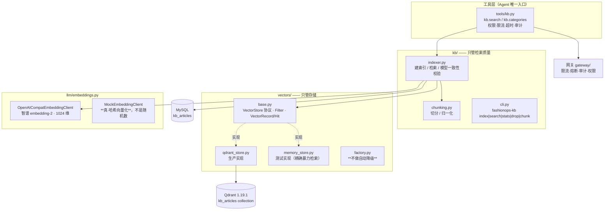

# 10 · 向量库选型与 RAG 实现

> 生成时间：2026-09-15（W7 提前落地）
> 用途：回答两个问题 —— **为什么选 Qdrant 而不是 Milvus**，以及**这套 RAG 是怎么实现的**。
> 本文档里的所有结论都来自实际跑过的代码，不是选型对比表的复述。

---

## 0. 一句话结论

**Qdrant 是当前规模与部署条件下的最优解，不是"普遍意义上比 Milvus 好"。**

我们的知识库是 **17 篇文章 → 17 个 chunk**。Milvus 的设计目标是 **上亿向量**
（分段合并、分布式查询、存储计算分离都是为这个量级服务的）。
在 17 条数据上用 Milvus，等于为了搬一张桌子去开一台起重机 ——
而且这台起重机需要 **etcd + MinIO** 才能启动，
**它们挂掉时 RAG 就整个不可用，而这两件事和检索质量没有任何关系。**

选型跟着规模走，不跟着 benchmark 走。

---

## 1. 为什么不用 Milvus（详细版）

### 1.1 部署复杂度：从 1 个进程变成 3 个以上

| 方案 | 最小可运行部署 | 进程数 |
| --- | --- | --- |
| **Qdrant** | 单个二进制 / 单容器，零外部依赖 | **1** |
| Milvus standalone | etcd + MinIO + milvus | **3** |
| Milvus cluster | etcd 集群 + MinIO/Pulsar + querynode/datanode/indexnode/proxy | **6+** |

Milvus 不是"配置麻烦"，而是**它的架构里就没有单进程形态**：
- **etcd** 存元数据（collection schema、segment 状态）
- **MinIO/S3** 存实际向量数据（Milvus 自己不落盘数据，它是计算层）

所以哪怕你只想存 17 条向量，也得先把对象存储和分布式 KV 跑起来。

**这不是理论担忧，是已经在别的项目里反复发生的事**：
MinIO 的 bucket 权限配错 → 向量写入静默失败；
etcd 磁盘满了 → 整个 Milvus 拒绝服务。
排查这两种故障需要的是 **S3/etcd 运维能力**，而不是 RAG 能力 ——
**引入的技术复杂度落在了和业务价值无关的地方**，这是最不划算的一种复杂度。

### 1.2 契合度：Milvus 的强项在我们这里用不上

Milvus 真正厉害的三件事：

| 能力 | 它解决什么问题 | 我们需不需要 |
| --- | --- | --- |
| **Segment 合并与索引重建** | 亿级数据持续写入时保持检索性能 | ❌ 我们是批量重建索引（`--rebuild`），17 条数据 0.3 秒建完 |
| **分布式查询** | 单机内存装不下向量时横向扩 | ❌ 17 × 1024 维 × 4 字节 ≈ **70 KB**，比一张图片还小 |
| **存储计算分离** | 存算独立扩容、多租户隔离 | ❌ 单体部署 |

反过来，Qdrant 的强项恰好全部命中我们的场景：

| 能力 | 对我们意味着什么 |
| --- | --- |
| 单二进制、零依赖 | Windows 上 `qdrant.exe` 解压即跑（开发期连 Docker 都没装过） |
| **过滤条件下推到 HNSW 遍历** | 客服场景必然要按类目过滤，见 §1.4 |
| Rust 实现、内存占用低 | 空载约 20 MB |
| payload 索引 + `wait=True` 语义清晰 | 建索引成功/失败能明确知道 |

### 1.3 一个必须说清楚的逻辑：这不是"谁更好"

面试时如果被追问"你是不是因为 Milvus 难装才不用它"，正确的回答是：

> Milvus 和 Qdrant 的差距不在**检索质量**上 —— 在我们的规模下，
> 两者的召回率差异落在噪声里。差距在**运维代价**上。
> 当向量数量从 17 涨到 1 亿，Qdrant 单机先撑不住，
> 而 Milvus 的分布式能力开始产生价值，那时候选型判断会**反过来**。
> 选型是规模、部署条件、团队能力的函数，不是某个 benchmark 的函数。

**如果出现下面任意一条，就应该换成 Milvus：**

1. 向量数量进入 **亿级**，单机内存/磁盘装不下
2. 需要**水平扩展**，且写入是持续高频的（不是我们这种批量重建）
3. 团队已有 **K8s + 专职中间件运维** 能力，etcd/MinIO 的复杂度不再是负担
4. 需要**存算分离**或多租户物理隔离
5. 团队已经在跑 Milvus —— **技术栈一致性带来的收益会盖过技术本身的优劣**

第 5 条最常被忽略，但它往往才是真实项目里的决定因素。

### 1.4 其余候选为什么也不行

| 方案 | 不选它的**具体**原因（不是"不够好"这种含糊说法） |
| --- | --- |
| **pgvector** | 我们已经在跑 MySQL。为了向量检索再引入并维护一个 PostgreSQL，是纯粹的运维成本翻倍。更要命的是：pgvector 的过滤是普通 SQL `WHERE` —— **没有过滤下推到 HNSW 遍历**，典型表现就是「先取 top-k 再过滤」，过滤条件一严结果就空掉。这是 pgvector 最常见的性能/正确性陷阱。 |
| **Chroma** | 嵌入式、零依赖，起步最省事，但它是**原型导向**的：过滤能力弱、量化/二进制量化等内存优化缺失、命名向量支持晚、API 历史上改动频繁（0.4 → 0.5 → 1.x 有破坏性变化）。用来做 demo 很合适，用来做"要讲工程决策"的项目不合适。 |
| **FAISS** | 它是一个**算法库**，不是服务：没有持久化、没有过滤、没有增删改、没有并发控制。所有这些都得自己写，而写出来的一定比 Qdrant 差。正确用法是"当成某个服务的内核"，不是"当成数据库"。 |
| **Elasticsearch / OpenSearch** | 有向量能力，但我们不需要它的全文检索（BM25 我们自己实现更可控），却要承担它的 JVM 堆调优、分片治理、许可证问题。**能力过剩 + 运维成本高**。 |
| **Weaviate** | 技术上可用，但社区规模、部署体验与 Qdrant 相比没有明显优势，且商业化边界更复杂。在"没有强理由换"的情况下，选更轻的那个。 |

---

## 2. 架构：这一层是怎么搭的

### 2.1 分层



### 2.2 为什么要 `VectorStore` 抽象（三个具体理由，不是"便于移植"）

"抽象是为了将来能换实现"是废话，任何抽象都能这么说。真实的理由是这三条：

1. **单元测试不能依赖外部服务。**
   57 个 KB 测试如果每个都要连 Qdrant，CI 上就得装 Qdrant；
   而"需要装东西才能跑的测试"最终会变成"没人跑的测试"。
2. **"测试通过 ≠ 生产能用"需要用真组件验证。**
   所以 `tests/test_vectors.py` 用 **同一份契约测试** 跑两个后端：
   `[memory]` 和 `[qdrant]` 各一遍，Qdrant 连不上自动 skip。
   这个设计立刻抓到了一个真 bug —— 见 §4。
3. **切分、BM25、RRF 融合、重排这些逻辑与存储无关。**
   它们只应该依赖接口。如果 `kb/` 直接 `import qdrant_client`，
   那么调切分参数也得起一个向量库才能验证。

### 2.3 `vectors/` 刻意"小"

这个抽象里**没有** ORM 式的文档模型（没有 `Document`、`Query`、`Chunk` 这些领域对象）。
这是刻意的：

> Qdrant 的 payload 过滤会**下推到 HNSW 遍历内部**（在走图的时候就跳过不匹配的点），
> 这是它相对 pgvector 的核心优势之一。如果为了"整洁"把 payload 包进一个领域模型，
> 这个下推能力就会被抽象层吃掉 —— 变成"先取 top-k 再过滤"，
> 于是过滤条件一严，返回结果就变空。
>
> **抽象层的厚度要小于它包住的能力，否则抽象是在减功能。**

---

## 3. 实现细节与背后的判断

### 3.1 切分（`kb/chunking.py`）

**为什么不能按固定字符数切：**

| 切法 | 后果 |
| --- | --- |
| 固定 500 字硬切 | 切在句子中间 → "退货需在收货后" / "7 天内申请" 各自残缺，命中哪一块喂给模型都是残缺信息 |
| 整篇不切（2000 字） | 向量把主题**平均化**了。一篇讲"尺码+退货+物流"的文章，和"怎么退货"的相似度被稀释，反而不如一篇只讲退货的短文 |
| 按句切 | 单句向量语义信息太少；同一篇产生大量近似重复的 chunk，把 top-k 挤满 |

所以实现是**结构化优先 + 尺寸兜底**：

```
1. 先按段落切（空行分隔）—— 段落是作者已经划好的语义边界，免费的信息
2. 小段落贪心合并到 target_chars 附近，避免碎片
3. 超长段落才按句子边界切，并加 overlap —— 
   重叠是为了不让关键信息正好落在切点上
4. 太短的尾块并入前一块 —— "半句话 chunk" 检索起来毫无价值，只会占位
```

参数：`target_chars=400`（约 400~600 token）、`overlap=60`（约 15%）、
硬上限 `MAX=900`、碎片下限 `MIN=30`。

**写测试时发现并修掉的一个真缺陷：**

短文本短路判断原本比的是 `MAX_CHUNK_CHARS`（900）而不是 `target_chars`（400）：

```python
if len(text) <= MAX_CHUNK_CHARS:   # ← 错
    return [text]
```

后果：一篇 **700 字、讲了尺码+退货+物流三件事**的文章，因为没超过 900
而被整篇返回成**一个** chunk，向量被三个主题平均化 ——
**正好是本模块开头说要避免的情况**。测试用一份 1700 字的长文档把它暴露了出来
（第一版测试数据只有 720 字，也没触发，说明**测试数据本身太短也会掩盖 bug**）。

### 3.2 `retrieval_text` 与 `content` 分开

`kb_articles` 里有两个正文字段：

| 字段 | 用途 | 特点 |
| --- | --- | --- |
| `content` | 展示给运营看的完整文章 | 有寒暄、铺垫、重复 |
| `retrieval_text` | **只喂给 embedding** | 标题 + 关键词 + 核心事实 |

不分开的后果：正文里"亲，感谢您的支持，我们会竭诚为您服务"这类句子
会把向量往"客服用语"的方向带偏，**降低区分度** ——
所有文章都变得"有点像客服文本"，互相之间的相似度差异被压平。

没有 `retrieval_text` 时退回 `标题 + 正文`，且**标题必须带上**：
只索引正文的话，搜"退货政策"可能召不回标题叫「退换货政策说明」
但正文里没出现这几个字的文章。

### 3.3 幂等与模型一致性（`kb/indexer.py`）

**chunk id 是确定性的**：`{article_no}#{chunk_index}`，例如 `KB0004#0`。
加上 Qdrant 适配器里的 `uuid5` 映射，重跑索引会**覆盖自己**而不是追加。

不这么做的常见后果：改一次切分参数重跑，库里就有两份数据，
检索时同一段内容被召回三次，top-k 里全是重复 —— **而且不报任何错**。

**换 embedding 模型必须重建。** 向量库本身不知道"这批向量是哪个模型生成的"。
新旧向量混在一起检索，会给出**看似正常但实际无意义**的相似度
（两个模型的向量空间完全不同）。所以：

- 每条记录 payload 里存 `embedding_model`
- 建索引时比对，不一致就**直接抛错**并告诉用户怎么修：

```
collection 里已有的向量是用 'embedding-2' 生成的，当前配置是 'text-embedding-3-small'。
两个模型的向量空间不兼容，混在一起检索的相似度没有意义。
建议重建：fashionops-kb index --rebuild
```

显式 `--rebuild` 时允许换模型（清空之后就不存在混用了），但会留一条告警。

**为什么宁可直接失败也不"自动重建"：** 自动重建在数据量小时很爽，
但它是**破坏性操作**——用户只是改了个环境变量想试试，
结果把整个索引清空了。破坏性动作必须显式。

### 3.4 "索引没建" ≠ "没找到答案"

这是整个 RAG 层**最重要的一条设计**，也是工具层 `reason` 字段存在的原因。

```python
search_kb("退货怎么处理")
  ├─ collection 不存在或为空 → raise RuntimeError("知识库还没建索引，先跑 fashionops-kb index")
  └─ 检索完但没有命中     → return []
```

工具层把它们翻译成两个不同的 `reason`：

| 情况 | `reason` | 给模型的 `hint` | 性质 |
| --- | --- | --- | --- |
| 索引没建 | `index_not_ready` | "这是**运维问题**：知识库索引没建。先跑 `fashionops-kb index`" | 系统故障 |
| 真的没相关内容 | `no_match` | "不要凭常识编造答案，应转人工处理" | 业务结论 |

**混为一谈的后果**：客服 Agent 会对用户说"知识库里没有这个问题的答案"，
而真实原因是运维忘了建索引 —— **用户得到的是一个假结论，
而且这个假结论听起来完全像是真的**。

这就是 `vectors/factory.py` **刻意不做自动降级**的同一个理由：

> 限流器降级不了的后果是"这一次没拦住请求"，影响可控；
> 向量库降级成空索引的后果是**检索永远返回空**，
> 而 Agent 会把"空"当成事实告诉用户。
> **静默变空比报错危险得多。**

（对比：限流组件的降级是可以接受的，因为它的失败是"漏过"而不是"给错答案"。）

### 3.5 离线向量化是**真的**按字面重合给分（`MockEmbeddingClient`）

它用**符号散列（signed hashing）**把 n-gram 特征映射到固定维度：
相同特征落到相同位置，所以余弦相似度**真的近似于文本的词汇重合度**。

**为什么不用随机向量**：随机向量也能让"维度对不对、写完读得到吗"通过，
但**检索质量完全测不了** —— 搜"退货"召回哪几篇是随机的，
于是检索断言只能退化成"返回了 3 条"，而真正该锁住的
"应该召回退货那篇"就测不到。

有了它，离线也能写有意义的断言：

```python
assert search_kb("退货怎么处理")[0]["article_no"] == "KB-0001"
```

**代价（必须诚实说明）**：它只懂字面重合，不懂语义。
搜"性价比"召不回只写"价格便宜"的文章 ——
而这**正是真实 embedding 的价值所在**，也是切到真模型后能讲出来的差异。

---

## 4. 只有跑两个后端才能发现的问题

`tests/test_vectors.py` 用同一份契约测试跑 `[memory]` 和 `[qdrant]` 两遍。
这个设计在第一次运行时立刻抓到了 4 个失败：

### 4.1 真 bug：Qdrant 返回的是存储层 UUID，不是调用方给的 id

| 后端 | 返回的 `VectorHit.id` |
| --- | --- |
| memory | `"near"`（调用方传什么就返回什么） |
| **qdrant** | `"6fa7f901-802c-58e9-..."` ← **UUID** |

根因：Qdrant 的 point id **只接受整数或 UUID**，所以适配器把 `"kb-0001#3"`
映射成 `uuid5`。第一版直接把存储层 id 返回了。

为什么危险：
- 调用方拿到的 id **无法反推来源**，排查时"这个向量是哪篇文章的"答不上来
- 两个后端**行为不一致** —— 而只跑一个后端时**完全看不出来**

修法：写入时把逻辑 id 存进 payload（`PAYLOAD_ID = "_id"`），检索时原样还回去。

> **存储层怎么编码 id 是实现细节，不该泄漏到接口上。**
> 这个 bug 的价值在于它证明了"契约测试跑多个后端"不是形式主义。

### 4.2 距离度量方向相反

欧氏/曼哈顿距离是**越小越相似**，余弦/内积是**越大越相似**。
如果不归一化，`search()` 的调用方得知道底层用的哪种距离 ——
而"过滤后按 score 排序"这类通用逻辑就写不出来。

修法：`_normalize_score()` 对 euclid/manhattan 返回 `1/(1+d)`，
**保证"越大越相似"是所有后端的统一语义**。

### 4.3 清空 ≠ 拆结构

`delete(collection)` 原本实现成"删掉 collection 再重建"，更"干净"，但很慢：
重建要重新为 4 个字段建 payload 索引（每个都是带 `wait=True` 的往返），
于是测试里每个用例多花十几秒，整个文件 **189 秒**。

改成「只删点、保留 collection」之后降到 **8 秒**（23 倍），
而且**语义更对**：清空数据本来就不该顺带把维度/索引这些**配置**扔掉。

另外补了独立的 `drop_collection()` 给"换 embedding 模型导致维度变了"的场景 ——
那时 collection 的 `size` 已固定、改不了，只能拆掉重建。

> 顺带的经验：**慢测试的下场是没人跑它。**
> 189 秒的文件在 CI 里会被"临时跳过"，然后渐渐没人记得它测什么。

### 4.4 一个自动化测试的自我校验

测试的 fixture 是 **session 级**建 collection、**function 级**清空点。
如果哪天有人改回"每个用例重建"，会立刻慢回去 ——
所以同时用一条注释说明了原因，而不是只把它写在这里。

---

## 5. 检索质量：实测证据

建索引：17 篇文章 → 17 个 chunk，写入 Qdrant `kb_articles`（1024 维，cosine，`embedding-2`）。

命令：`fashionops-kb search "<问题>" --top-k 3`

| 查询 | #1 命中 | 类目 | score | 说明 |
| --- | --- | --- | --- | --- |
| 裙子洗了会不会掉色 | **掉色正常吗** | 材质 | 0.5770 | ⭐ **语义召回**：query 里没有"掉色"以外的共同词，靠语义而非字面 |
| 能不能开发票 | 能开增值税发票吗 | 发票 | 0.4438 | 正确 |
| 发什么快递几天到 | 多久发货 | 物流 | 0.4847 | 前两名都是物流类目 |
| 退货怎么处理 | 换货要多久 | 退换货 | 0.5713 | ⚠️ **top-1 不稳定**：与 #2「支持七天无理由吗」（0.5697）**只差 0.002** |

### 必须诚实说明的限制

1. **`退货怎么处理` 这个短查询的 top-1 是噪声级判断。**
   0.5713 vs 0.5697 的差距在度量误差内。原因是种子数据每篇
   `retrieval_text` 只有一句话，信息量太少，向量区分度不足。

   **这正是需要评测集（eval set）的原因** ——
   单看一两次搜索会得出完全错误的结论：换个词序就可能"变差"，
   而实际上什么都没变。用 N 个 query、看 top-k 命中率，才能说"检索质量如何"。
   这是下一步（§7）的第一优先级。

2. **种子语料太短，多块路径在真实数据上跑不到。**
   17 篇的 `retrieval_text` 都 < 400 字，所以每篇恰好 1 个 chunk。
   多块切分的正确性目前由 `tests/test_kb.py` 里的**合成长文档**保证，
   真实语料上还没验证过。

3. **没有 BM25 / 混合检索 / 重排。** 现在是纯向量召回。
   关键词类查询（商品编号、活动名）会明显弱于向量类查询。

4. **没有分块级的上下文扩展。** 命中第 3 块时，不给第 2、4 块作为上下文，
   可能丢掉跨块的语义。

---

## 6. 怎么用

### 6.1 命令行

```powershell
cd "c:\Users\Administrator\Desktop\Work agent\platform"

.venv\Scripts\fashionops-kb.exe index              # 建索引（幂等，可反复跑）
.venv\Scripts\fashionops-kb.exe index --rebuild     # 先清空再建（改了切分参数后用）
.venv\Scripts\fashionops-kb.exe search "退货怎么处理" --top-k 3
.venv\Scripts\fashionops-kb.exe search "退货" --category 退换货
.venv\Scripts\fashionops-kb.exe stats               # 向量数/维度/模型/探活
.venv\Scripts\fashionops-kb.exe drop --yes          # 删掉整个 collection（危险）
.venv\Scripts\fashionops-kb.exe chunk "一段很长很长的文本……"   # 预览切分效果，调参用
```

`chunk` 子命令是**调切分参数时的工具**：改 `--target-chars` / `--overlap-chars`
直接看切出来什么样，不用真的建一遍索引。

### 6.2 Agent 视角：两个工具

| 工具 | 权限 | 只读 | 限流 | 超时 |
| --- | --- | --- | --- | --- |
| `kb.search` | `kb:read` | ✅ | 60/分 | 15s |
| `kb.categories` | `kb:read` | ✅ | 60/分 | 15s |

`kb.categories` 存在的理由：Agent 想按类目过滤时，得先知道有哪些**合法值**。
没有这个工具，它只能猜 —— 而猜错的后果是**把正确答案过滤掉**，
而且不会报错，只是检索不到。

### 6.3 配置（`.env`）

```ini
FASHIONOPS_QDRANT_URL=http://127.0.0.1:6333
FASHIONOPS_QDRANT_COLLECTION_KB=kb_articles
FASHIONOPS_QDRANT_TIMEOUT=10

# 留空则跟随 model_provider / model_api_key（智谱同一个 Key 同时管 chat 和 embedding）
FASHIONOPS_EMBEDDING_PROVIDER=zhipu
FASHIONOPS_EMBEDDING_MODEL=embedding-2
FASHIONOPS_EMBEDDING_DIM=1024          # 必须和模型实际维度一致
```

**没配 Key 时会降级为 mock 向量化并打一条 warning** ——
检索仍可用，但只有字面匹配能力。这个降级是**安全的**：
它不会让结果变空，只是变差，而且日志里有明确记录。

---

## 7. 还差什么（按优先级）

| 优先级 | 项 | 为什么重要 |
| --- | --- | --- |
| **P0** | **评测集 + 命中率指标** | 没有它，"检索质量"这件事无法量化，改任何参数都是盲调。至少要 30~50 个 query 标注正确文章，报 top-1 / top-3 / MRR |
| **P1** | BM25 关键词召回 + RRF 融合 | 纯向量对编号类、活动名类查询很弱。混合检索是 RAG 的标准答案 |
| **P1** | 重排（rerank） | 召回 20 条 → 重排取 3 条，通常比直接召回 3 条好得多 |
| **P2** | 真实语料的多块验证 | 现在多块路径只被合成数据覆盖过 |
| **P2** | 分块上下文扩展 | 命中某块时把前后块一起给模型 |
| **P2** | 客服 Agent 本体 | 现在只有检索工具，没有用它的 Agent。**这是这一层最终的服务对象** |
| **P3** | 工单向量化（`tickets` collection） | 配置项 `qdrant_collection_tickets` 已留好，用于"相似工单"推荐 |
| **P3** | 语义缓存 | 相似问题命中缓存，省 embedding 成本 |

---

## 8. 相关文件与测试

| 文件 | 行数 | 职责 |
| --- | --- | --- |
| `vectors/base.py` | 198 | `VectorStore` 协议、`Filter`、`VectorRecord`/`VectorHit`、payload 键常量 |
| `vectors/qdrant_store.py` | 429 | Qdrant 适配器（id 映射、score 归一化、payload 索引、健康探活） |
| `vectors/memory_store.py` | 198 | 暴力精确检索，**确定性 tie-break**（避免 flaky test） |
| `vectors/factory.py` | 86 | 单例工厂，**不做自动降级**（理由见 §3.4） |
| `kb/chunking.py` | 214 | 切分与归一化 |
| `kb/indexer.py` | 282 | 建索引、检索、模型一致性校验 |
| `kb/cli.py` | 200 | `fashionops-kb` 命令 |
| `llm/embeddings.py` | 322 | embedding 客户端（真 + mock） |
| `tools/kb.py` | 191 | `kb.search` / `kb.categories` 工具 |
| `tests/test_vectors.py` | 386 | **契约测试，双后端参数量**（26 项） |
| `tests/test_kb.py` | 784 | 切分 / 离线向量化 / 索引检索端到端 / 工具契约（55 项） |

**测试特点：全程离线。** 不连 MySQL、不连 Qdrant、不连智谱 ——
settings/store/embedder 全部**显式传参注入**，
所以开发者本地 `.env` 里配了真 Qdrant 和真 Key 也不会改变测试行为。

---

## 9. 一句话总结（可以直接拿去讲）

> 知识库这一层我用 Qdrant 而不是 Milvus，是因为 Milvus 是**分布式优先**的架构 ——
> 最小部署就要 etcd + MinIO，它的强项（亿级向量的分段合并、分布式查询、
> 存算分离）在我这个 17 篇文章的规模上全部用不到，
> 而 etcd 或 MinIO 挂掉会让 RAG 整个不可用，**那两件事和检索质量毫无关系**。
> Qdrant 是单二进制、零依赖，过滤条件下推到 HNSW 遍历，正好匹配"必按类目过滤"的客服场景。
>
> 我把它写成了一个小接口 + 两个实现：生产用 Qdrant，测试用内存实现。
> 这不是为了"将来好换"，而是因为**同一个契约测试跑两个后端** ——
> 它立刻抓到了一个真 bug：Qdrant 返回的是存储层 UUID 而不是调用方给的 id，
> **只跑一个后端完全看不出来**。
>
> 检索质量方面我给了实测证据，也明确说了限制：
> 短查询的 top-1 会在 0.002 的差距内翻转，所以下一步第一优先级是**建评测集**，
> 而不是继续调参 —— 没有评测集，"检索质量变好了"这句话是不可验证的。
