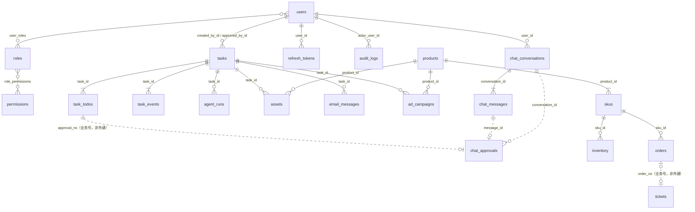

# 13. 数据模型与库表设计

> 本文档基于**真实数据库**导出（`information_schema`），不是照着模型猜的。
> 取数时间：2026-09-18 · MySQL 8.0.43 · 库 `fashionops` · 引擎 `mysql+pymysql`。

## 0. 一句话结论

**28 张表已经建好、5 个迁移、库在 `head`（`b7c1e9a2f4d8`），覆盖全部业务域。
不需要从零重建——需要做的是「收口」**：清掉旧执行架构留下的字段、把几处
"靠业务号硬连"的关系说清楚、补一个漏掉的列注释。

`alembic check` 目前只有 **1 处差异**（`chat_approvals.todo_seq` 的列注释在库里没落上），
其余字段/索引/外键与模型**完全一致**。

---

## 1. 表清单（按域分组）

行数取自 `information_schema.TABLES` 的统计值（InnoDB 是估算）。

### 1.1 身份与权限（7 张）

| 表 | 行数 | 用途 | 来源模块 |
|---|---|---|---|
| `users` | 3 | 账号本体（密码、锁定、登录痕迹） | `db/models_identity.py` |
| `roles` | 5 | 角色（含 `is_system` 防误删） | 同上 |
| `permissions` | 16 | 权限码（身份域，不是网关 scope） | 同上 |
| `user_roles` | 2 | 用户 ↔ 角色 多对多 | 同上 |
| `role_permissions` | 52 | 角色 ↔ 权限 多对多 | 同上 |
| `refresh_tokens` | 41 | 刷新令牌（轮换链 `replaced_by_id`） | 同上 |
| `api_keys` | 0 | 机器账号密钥 | 同上（**已建模，暂无接口用它**） |
| `external_identities` | 0 | 第三方登录绑定 | 同上（OAuth 已接线，只是没人绑过） |

### 1.2 商品 / 库存 / 交易（5 张）

| 表 | 行数 | 用途 |
|---|---|---|
| `products` | 60 | SPU：款（类目/季节/成本/吊牌价/评分） |
| `skus` | 512 | SKU：款下的色码（唯一约束 `product_id+color+size`） |
| `inventory` | 7302 | 库存**流水**（入库/出库/销售/退货/盘盈亏/锁定），带 `quantity_after` 冗余 |
| `orders` | 800 | 订单（含 `product_title` 下单快照、`channel`、`is_new_customer`） |
| `competitors` | 80 | 竞品价格与销量（含 `price_history` 近 30 天） |

### 1.3 任务执行（新架构，5 张）

> 下面是**灌完演示数据之后**的行数（2026-09-18 重新灌过一遍）。

| 表 | 行数 | 用途 |
|---|---|---|
| `tasks` | 20 | 任务主表（需求原文、状态、进度、计量、审批人留痕） |
| `task_todos` | 25 | **有序步骤列表**——它同时就是"计划"和"进度" |
| `task_events` | 151 | 事件流（SSE 数据源，`task_id+seq` 唯一） |
| `agent_runs` | 78 | 单次执行记录（评测与成本归因的数据源） |
| `assets` | 50 | 素材（报表/图/视频），落盘 + 登记 |

### 1.4 通知与审计（2 张）

| 表 | 行数 | 用途 |
|---|---|---|
| `email_messages` | 36 | 邮件（含闸门判定 `gate_decision`、审批人、附件） |
| `audit_logs` | 416 | 审计（**网关调用**和**接口操作**共用一张表，`tool_name` 区分来源） |

### 1.5 对话（3 张）

| 表 | 行数 | 用途 |
|---|---|---|
| `chat_conversations` | 1 | 会话 |
| `chat_messages` | 9 | 消息（含 tool_call 回执、`task_no` 反查） |
| `chat_approvals` | 2 | **人工闸口（对话与任务共用）** |

### 1.6 客服与知识库（2 张）

| 表 | 行数 | 用途 |
|---|---|---|
| `tickets` | 60 | 工单（意图/情绪/升级/命中文章号） |
| `kb_articles` | 17 | 知识库文章（向量在 Qdrant，**不在这张表里**） |

### 1.7 广告与 BI（2 张）

| 表 | 行数 | 用途 |
|---|---|---|
| `ad_campaigns` | 12 | 广告计划（预算/消耗/ROI/审批） |
| `bi_metrics` | 240 | 日度经营指标（按日期+类目唯一） |

### 1.8 迁移（1 张）

`alembic_version`：当前 `b7c1e9a2f4d8`。

---

## 2. 它们怎么连在一起

### 2.1 外键（30 条，数据库层强制）

```
users ──┬─< user_roles >── roles ──< role_permissions >── permissions
        ├─< refresh_tokens（含 replaced_by_id 自引用：轮换链）
        ├─< api_keys（owner_id）
        ├─< external_identities
        ├─< chat_conversations ──< chat_messages ──< chat_approvals（message_id）
        ├─< tasks（created_by_id / approved_by_id）
        ├─< audit_logs（actor_user_id）
        ├─< email_messages（approved_by_id）
        └─< users（created_by_id 自引用：谁建了这个账号）

tasks ──┬─< task_todos（task_id）       ← 新架构：步骤
        ├─< task_events（task_id）      ← 事件流（uq_task_event_seq）
        ├─< agent_runs（task_id）
        ├─< assets（task_id）
        ├─< email_messages（task_id）
        ├─< ad_campaigns（task_id）
        └─< audit_logs（task_id）

products ──< skus ──< inventory
                  └─< orders
products ──< assets（product_id）
products ──< ad_campaigns（product_id）
```

### 2.2 业务号关联（**刻意不做外键**，应用层保证）

| 关系 | 字段 | 为什么不做外键 |
|---|---|---|
| todo → 审批单 | `task_todos.approval_no` → `chat_approvals.approval_no` | 审批单要能**独立于任务活下来**做审计（任务被清理后，"谁批了这封邮件"仍要答得上来）；做成外键就得跟着 CASCADE 删 |
| 任务 → 审批单 | `chat_approvals.task_no` → `tasks.task_no` | 同上 |
| 工单 → 订单 | `tickets.order_no` → `orders.order_no` | 工单来自外部渠道，订单号可能还没同步进来；做成外键会让"接单"变成"接不到" |
| 素材引用 | `tasks.result.artifacts`、`email_messages.attachments`、`chat_messages.tool_result` 里的 `asset_no` | 引用写在 JSON 里（当时的执行结果快照）。**保持快照语义**，不要改成外键——改了之后"当时那封邮件挂了哪个附件"就随素材删除而变了 |

### 2.3 ER 图



---

## 3. 关键设计取舍（**别改错方向**）

### 3.1 `task_todos` 同时是"计划"和"进度"

新架构把计划从"模型出 DAG"换成"代码出线性列表"（见 `docs/12-AI协作交接.md` §5）。
于是**不需要两张表**：`task_todos` 一行 = 一步的目标（计划）+ 状态/结论/耗时（进度）。

代价是 `tasks.dag` 这个字段名**名不副实**（见 §4 问题 1）。

### 3.2 `chat_approvals` 是"一张表服务两个入口"

它最早只服务对话（所以叫 `chat_approvals`），后来任务侧的闸口也需要，
就加了 `task_no` / `todo_seq` 两个字段复用同一张表。

**为什么合并而不是各存一份**：
- "现在有几个闸口卡着人"这条查询只写一次（否则一张表 + 一个 JSON 字段，而 JSON 字段没法加索引）
- "这个工具要不要审批"的判据只有一份（`approval/policy.py`），分成两份必然漂移
- 任务的审批有**独立行**，"谁批的/什么时候/批准后执行成什么"三个问题才答得上来

**为什么不改表名**：`conversation_id` 上有外键，MySQL 里 `DROP INDEX` 会被外键挡
（errno 1553），而且 SQLite 的 `batch_alter_table` 是重建整表，会让"迁移过的库"和
"新建的库"索引名分叉，`alembic check` 会一直报警。**纯装饰性的重命名不值得赌一个高风险迁移。**

### 3.3 事件流的 `seq` 靠内存计数 + 首读基线

`task_events(task_id, seq)` 有唯一约束 `uq_task_event_seq`。
`TaskRecorder` 用内存计数递增，**但首次用到某个任务时必须先从库里取 max(seq)**。

> 踩过的坑：resume 时新建的 `TaskRecorder` 计数从 1 开始 → 撞唯一约束 → 插入失败被
> 容错吞掉 → 表现是"批准之后的所有事件都不见了"，日志里只有一行 warning。
> 这条现在是回归测试（`tests/test_recorder.py::test_seq_is_continuous_across_recorder_instances`）。

### 3.4 审计一张表两个来源

`audit_logs.tool_name`：
- 网关调用填工具名（`mail.send` / `erp.query_candidates`）
- 接口操作填 `api:<路由>`

**为什么不分两张表**：排查时经常要"把某个任务的工具调用和人工操作按时间排在一起看"，
分表就得做 UNION，而字段本来就高度重合。

### 3.5 订单里冗余了商品名

`orders.product_title` 是**下单时的快照**。商品改名之后，历史订单仍然要显示当时的名字——
这是"订单"和"商品"之间刻意保留的**反范式**。

---

## 4. 体检：现在有什么问题

按"会不会咬人"排序。

### P0 · `tasks` 上有 3 个旧架构留下的字段（名不副实 / 已无人写）

| 字段 | 现状 | 说明 |
|---|---|---|
| `state` | **已无人写** | 原 LangGraph state 快照（`runner` 已删除）。库里可能还有历史值 |
| `thread_id` | 仍在写，但只是 `task_no` 的副本 | 原 checkpoint 的 thread_id；没有 checkpoint 之后它没有意义 |
| `dag` | 在写，但装的是 **todo 计划**（`{mode:"todo_list", todos:[...], steps:[...]}`） | 字段注释仍写着"DAG 定义：nodes + edges" |

**为什么必须处理**：这三个字段是"读代码的人会被误导"的典型——
新来的人看到 `dag` 会以为计划还是图，看到 `state` 会以为有状态机。
交接文档里已经解释过一遍，但**字段本身还在说谎**。

**建议**：写一个迁移，把 `state` / `thread_id` 标注为废弃（或在读取层不再暴露），
把 `dag` 的注释改成"计划（线性 todo 列表，历史行可能是旧 DAG 形状）"。
**先别删列**——历史行还有值，删了就查不到旧任务当时在干什么。

### P1 · `task_todos.approval_no` 等逻辑外键没有约束

优点是可以让审批单活得比任务久；代价是**可能出现孤儿引用**
（todo 指向一张被删掉的审批单）。建议：不要加外键，而是加一个**巡检脚本**
（`scripts/` 下）定期检查"待处理审批单指向的任务是否存在"。
**用检查代替约束**，是这两者之间的正确取舍——约束会挡住正常的清理流程。

### P1 · `tasks.result` 的历史脏数据

已发现一行 `T260908009.result = "null"`（**字符串**，早期把 JSON 列当文本写进去）。
它导致 `GET /api/v1/tasks?page_size=200` 直接 500（只在脏数据落进分页区间时炸，所以藏了很久）。

已在 `TaskOut` 用前置校验器兜住（字符串就 `json.loads`，解不出 dict 当 None），
**没有动库里的数据**（原则见 §8.5：不为演示脏数据写迁移脚本）。

### P2 · `chat_approvals.todo_seq` 列注释没落库

`alembic check` 唯一的差异。模型里有注释"任务侧：第几个 todo"，库里没有。
补一个 `modify_comment` 的迁移即可，让 `alembic check` 干净。

### P2 · 两张"已建模未接线"的表

- `api_keys`（0 行）：模型、索引、唯一约束都齐了，**但没有接口用它**。
  要么接上（机器账号调用接口），要么在文档里写明"为下一阶段预留"。
  现在的状态最容易被误读成"已经支持 API Key 调用"。
- `external_identities`（0 行）：OAuth 代码路径**已经接了**（`security/oauth.py`），
  0 行只是因为没人用第三方登录过。这个没问题。

### P2 · 知识库的向量不在 MySQL

`kb_articles` 只存文本和 `retrieval_text`，**向量在 Qdrant**（6333）。
这是刻意的（向量检索不该压在关系库上），但意味着：
- 备份必须**两边一起备**，只备 MySQL 会丢掉检索能力
- `kb_articles` 改了内容后，Qdrant 里的向量要同步重建（目前没有自动同步）

---

## 5. 如果要从零建一套：怎么做

### 5.1 建库命令（现有资产够用，不用重写）

```powershell
cd "c:\Users\Administrator\Desktop\Work agent\platform"

# 1) 建表（从零库开始，依次跑 5 个迁移到 head）
.venv\Scripts\python.exe -m alembic upgrade head

# 2) 灌演示数据（商品/SKU/库存/订单/竞品/BI/知识库/工单）
.venv\Scripts\fashionops-seed.exe

# 3) 补角色权限预设 + 建管理员
.venv\Scripts\fashionops-user.exe sync --apply-presets

# 4) 自检：模型和库是不是一致（期望输出 No changes）
.venv\Scripts\python.exe -m alembic check
```

> **测试不走迁移**：单测用 `Base.metadata.create_all()` 在临时 SQLite 上建表
> （`tests/conftest.py` 的 `db` 夹具把 `db.base.get_settings` 指向 `tmp_path`）。
> 这样测试不依赖外部状态，也不会污染开发库。
> 只有 `tests/test_api_mysql.py` 故意打真实 MySQL —— 它专抓 SQLite 上不复现的问题
> （分页、并发、utf8mb4、时区）。

### 5.2 5 个迁移对应什么

| 迁移 | 内容 |
|---|---|
| `0484f1659d5e` | 初始 15 张业务表（商品/SKU/库存/订单/竞品/广告/BI/知识库/任务/事件/运行/素材/邮件/审计/工单） |
| `390b0093fe48` | 对话三张表（`chat_conversations` / `chat_messages` / `chat_approvals`） |
| `932e1a8b1a51` | 身份与 RBAC（users/roles/permissions/关联表/refresh_tokens/api_keys/external_identities）+ 审计补 `actor_user_id` |
| `b7c1e9a2f4d8` | **`task_todos` + 审批表通用化**（加 `task_no` / `todo_seq`）—— 新架构的数据层 |
| `d5eb1be3d355` | 工单补 `agent_handled_at` / `agent_lane` |

### 5.3 假数据是怎么造出来的（新架构版）

`fashionops-seed` 现在不只灌商品/订单，它**按新架构把"跑过的痕迹"一起造出来**：

| 造的东西 | 由谁产出 | 说明 |
|---|---|---|
| 任务的步骤拆分 | 直接调 `agents/workplan.plan_todos()` | **和线上同一个函数**，所以假数据里的步骤永远是真实规则的样子，不会分叉 |
| `task_todos` | `generators.make_task_todos()` | 按任务终态反推每一步的状态：done / running / waiting_approval / failed / skipped |
| `task_events` | `generators.make_task_events()` | 用新架构的事件词汇（`task_planned` / `todo_started` / `tool_call` / `approval_required` / `task_finished`…），seq 从 1 连续 |
| `agent_runs` | `generators.make_agent_runs()` | `agent_name = "task"`，`node_name = todo-N` |
| 待确认的审批单 | seed 里补 | 停在闸口的任务会配一张 `chat_approvals` 行，并把 `approval_no` 写回那一步 |
| 对话演示数据 | `generators.make_chat_demo()` | 三条会话，覆盖"直接答 / 建任务 / 停在闸口"三种结局 |

**两条刻意的保证**：
1. **至少有一个任务卡在人工闸口**（`_ensure_one_waiting_approval`）——
   随机抽状态的话某些种子下一次都抽不到，而"不可撤销的动作会停下来等人"
   恰恰是这个项目最该被看到的东西。
2. **只有含审批步骤的任务才可能卡闸口** ——
   否则会出现"一步查库存的任务在等人确认发邮件"这种一眼假的数据。

### 5.4 灌库会**连账号一起删**（已修，别再踩）

`seed(reset=True)` 走 `Base.metadata.drop_all()`，而身份表也在 metadata 里，
所以灌完库是**登不进去**的（表现是登录一直 401，看起来像鉴权坏了）。

现在 `seed()` 一开场就 `_bootstrap_identity()`：同步权限码与内置角色 → 建演示账号
（`demo` / `ops_manager` / `operator`，密码都是 `FashionOps@2026`）。
这样"灌完就能登进去看"这条路径是通的。

### 5.5 设计原则（沿用现有这套，别推翻）

1. **业务号 ≠ 外键**。跨生命周期的对象（审批单、订单号）用业务号关联，靠索引和巡检保证
   一致性；同一生命周期内的（任务 ↔ 步骤 ↔ 事件）用外键，让数据库兜底。
2. **可快照的字段就快照**（`orders.product_title`、`chat_messages.tool_result`）。
   "当时发生了什么"和"现在是什么"是两件事，混在一起审计就失真。
3. **JSON 只放"整体读、不按内部字段查"的数据**（计划、参数、结果摘要）。
   一旦要按里面的字段筛选，就该提成列——`chat_approvals` 从"任务的 JSON 字段"
   变成独立表就是这个判断的结果。
4. **表和字段都要写注释**。这个项目靠注释把"为什么"留在代码里，
   `alembic check` 也会比对注释，注释缺失会被当成 schema 漂移。
5. **不为演示脏数据写迁移**，在读取时兼容（§8.5 的原则）。

---

## 6. 日常运维查询

```sql
-- 一个任务的全貌（步骤 + 结论 + 计量）
SELECT t.task_no, t.status, t.total_tokens, t.llm_calls,
       d.seq, d.kind, d.status AS todo_status, d.tool_names, LEFT(d.result_summary, 80) AS summary
FROM tasks t LEFT JOIN task_todos d ON d.task_id = t.id
WHERE t.task_no = 'T260917043251A36E' ORDER BY d.seq;

-- 审批链路（谁批了什么、执行结果如何）
SELECT a.approval_no, a.task_no, a.todo_seq, a.tool_name, a.status,
       a.decided_by, a.decided_at, a.preview
FROM chat_approvals a ORDER BY a.created_at DESC LIMIT 20;

-- 成本归因（按 Agent / 按天）
SELECT agent_name, DATE(created_at) AS d, COUNT(*) AS runs,
       SUM(total_tokens) AS tokens, SUM(cost) AS cost
FROM agent_runs GROUP BY agent_name, DATE(created_at) ORDER BY d DESC;

-- 卡在闸口的任务（前端"待我确认"的数据源）
SELECT task_no, status, created_at FROM tasks WHERE status = 'waiting_approval';

-- 孤儿引用巡检（task_todos 指向不存在的审批单）
SELECT d.task_id, d.seq, d.approval_no FROM task_todos d
LEFT JOIN chat_approvals a ON a.approval_no = d.approval_no
WHERE d.approval_no IS NOT NULL AND a.id IS NULL;
```
