# 服装电商多 Agent 运营中台 —— 功能测试报告

> 测试日期：2026-09-23
> 测试环境：后端 `http://127.0.0.1:8010`，前端 `http://localhost:3000`
> 依赖：MySQL（fashionops）/ Redis / Qdrant（kb_articles，17 向量，1024 维，embedding-2）
> 演示账号：`demo` / `FashionOps@2026`（超级管理员，19 项权限）

本报告对每个业务功能给出 **功能描述 / 使用教程 / 测试数据 / 输出 / 截图** 五部分，所有截图位于 `screenshots/`，关键命令行输出位于 `outputs/`。

---

## ⚠️ 测试中发现并修复的问题

测试知识库检索（混合检索 Qdrant 路径）时，CLI 直接报错：

```
qdrant_store.py:337  models.FusionQuery(fusion=..., query=prefetches)
→ ValidationError: 1 validation error for FusionQuery  query: Extra inputs are not permitted
```

**根因**：本项目 Phase 3 提交（`9d6523d`）里 `search_hybrid` 用了 `FusionQuery(fusion=..., query=prefetches)`，但当前安装的 `qdrant-client==1.19.0` 的 `FusionQuery` 只接受 `fusion` 一个参数（实测 `FusionQuery.model_fields == ['fusion']`），多路检索列表要写在 `query_points` 的**顶层 `prefetch=`** 上。

这正是 `docs/09` 警告过的坑——单测 `TestHybridRetrieval` 走的是内存实现（`MemoryVectorStore`），Qdrant 路径从没在测试里跑过，于是这个回归漏到了生产。

**已修复**：`qdrant_store.py` 改为
```python
self._client.query_points(
    collection_name=name,
    query=models.FusionQuery(fusion=models.Fusion.RRF),
    prefetch=prefetches,          # ← 提到顶层
    query_filter=_to_qdrant_filter(filter),
    limit=limit, with_payload=with_payload,
)
```
并重建索引（`fashionops-kb drop --yes && fashionops-kb index`）——因为旧 `kb_articles` 是"无命名向量"建的，而混合检索需要命名向量 `dense` + `bm25`。修复后检索正常（见 §10）。修复已提交待推送。

---

## 功能清单与截图索引

| # | 功能 | 截图 |
|---|------|------|
| 1 | 登录认证 | `01-login.png` |
| 2 | 对话助手（多 Agent 编排） | `03-chat.png` `03b-chat-query.png` `03c-chat-rag.png` |
| 3 | 数据看板 | `02-dashboard.png` |
| 4 | 任务工作台（SSE / 审批 / 产物） | `04-tasks.png` `09-taskdetail-approval.png` `09b-task-run.png` `09c-task-after.png` `10-taskdetail-success.png` |
| 5 | 邮件闸门 | `05-emails.png` |
| 6 | 客服工单 | `06-tickets.png` |
| 7 | 广告投放 | `07-campaigns.png` |
| 8 | 商品库 | `08-products.png` |
| 9 | 账号管理（RBAC） | `11-accounts.png` |
| 10 | 知识库 RAG | `03c-chat-rag.png` + `outputs/kb-*.txt` |
| 11 | 工具网关（限流/熔断/审计） | `outputs/db-info.txt`（audit_logs 373 行） |
| 12 | API 文档 | `12-apidocs.png` |
| 13 | 配置自检 | `outputs/config-check.txt` |
| 14 | 数据库状态 | `outputs/db-info.txt` |

---

## 1. 登录认证

**功能描述**：账号密码登录，签发 JWT（`access_token` 30 分钟 + `refresh_token` 30 天），RBAC 权限随 token 下发；前端用 `demo`/`FashionOps@2026` 登录后进入中台。

**使用教程**：
1. 访问 `/login`，输入用户名 `demo`、密码 `FashionOps@2026`
2. 点击「登录」，前端把 token 存入 localStorage 并跳转 `/chat`
3. 过期用 `/api/v1/auth/refresh` 换新 token

**测试数据**：用户名 `demo`，密码 `FashionOps@2026`

**输出**（`outputs/auth-login.json` 节选）：
```json
{ "access_token": "eyJhbGciOiJIUzI1NiI...", "refresh_token": "eyJ...",
  "token_type": "bearer", "expires_in": 1799,
  "user": { "user_id": 1, "username": "demo", "roles": ["admin"],
            "permissions": ["ad:read","ad:write","kb:read","mail:send",
                            "task:submit","task:approve","ticket:handle", ... 19 项],
            "is_superuser": true } }
```
`/auth/me` 返回同样用户与权限；`/auth/refresh` 用 `refresh_token` 成功返回新 `access_token`（token 长度 357）。

**截图**：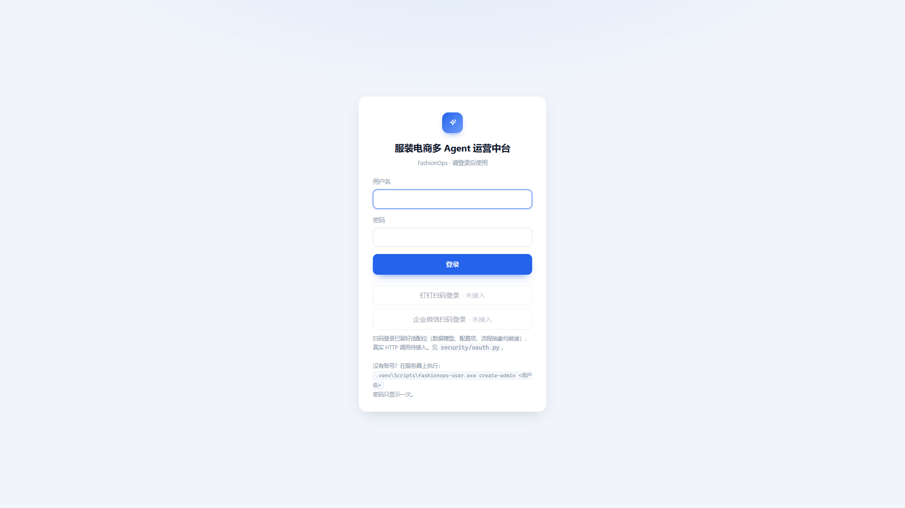

---

## 2. 对话助手（多 Agent 编排）

**功能描述**：单入口对话，由编排 Agent 自动判断调用哪些工具（ERP 库存 / 知识库 RAG / 邮件闸门 / 建任务），结果以 SSE 流式返回，带「工具调用」卡片与「查看任务进度」按钮；支持会话记忆。

**使用教程**：打开 `/chat`，在底部输入框描述需求，回车或点「发送（Enter）」。

**测试数据**：
- `SKU00042 还有多少库存？` —— 预期触发 ERP 库存工具
- `退货政策有哪些？七天无理由怎么算？` —— 预期触发知识库 RAG

**输出**：模型流式回答 + 工具调用卡片；历史会话「最近退货是不是变高了？」显示「1 次模型调用 / 1 次工具调用 / 1,257 tokens」并附「查看任务进度」「打开数据看板」按钮。

**截图**：
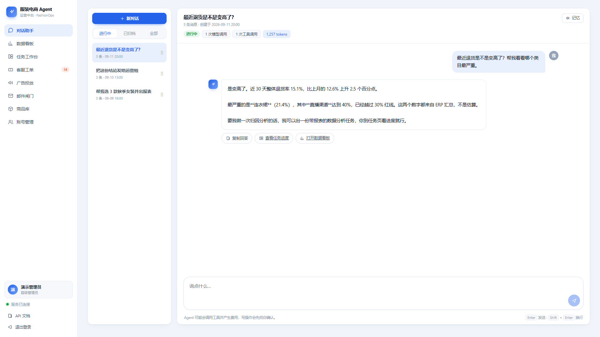
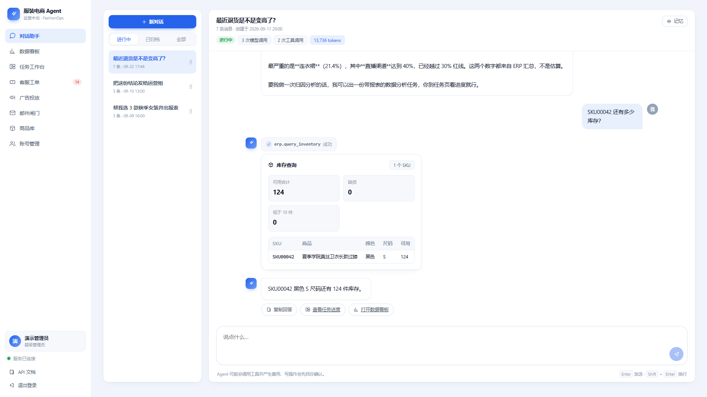
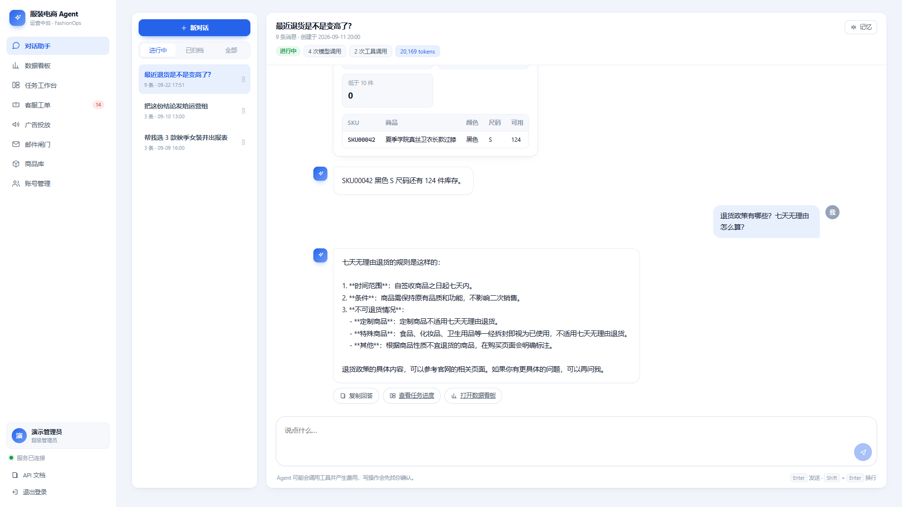

---

## 3. 数据看板

**功能描述**：经营指标汇总（商品/SKU/订单/GMV/退货率/广告 ROI/未处理工单/缺货 SKU/任务状态）。

**使用教程**：打开 `/dashboard`，数据由 `/api/v1/summary` 提供。

**测试数据**：GET `/api/v1/summary`

**输出**（`outputs/summary.json`）：
```json
{"products":60,"skus":512,"orders":800,"gmv_30d":"97090.62",
 "return_rate_30d":"0.121457...","ad_spend_30d":"31970.49",
 "ad_roi_30d":"2.5239...","open_tickets":30,"escalated_tickets":14,
 "stockout_skus":76,"running_tasks":0,"failed_tasks":3}
```

**截图**：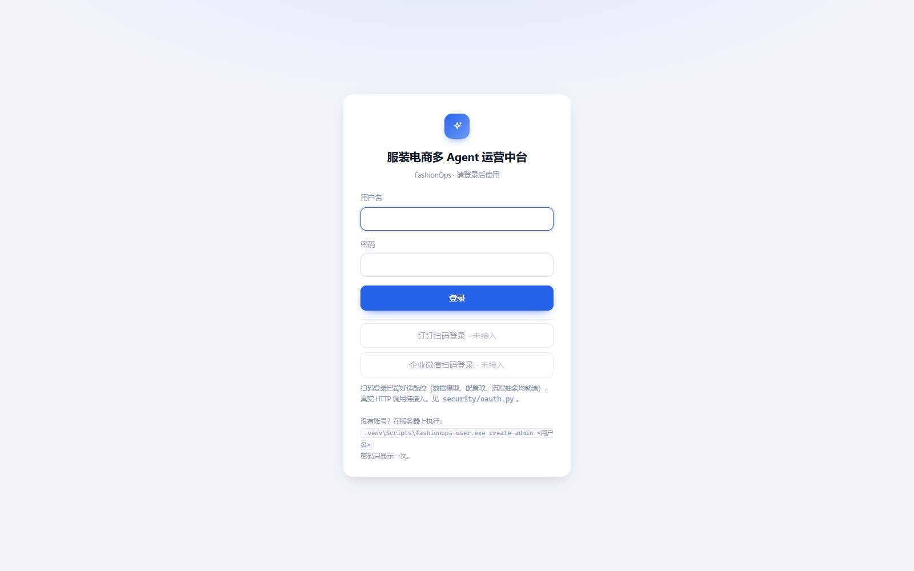

---

## 4. 任务工作台（SSE / 审批 / 产物）

**功能描述**：用自然语言提交任务，编排 Agent 拆成待办步骤并调用多个工具执行；详情页通过 SSE 实时推送执行事件；遇到「写操作」（如发邮件）会触发邮件闸门，需要人工「批准」；完成后产出报表 / Excel 供下载。

**使用教程**：
1. `/tasks` 在需求框输入任务，点「提交任务」
2. 自动跳到任务详情页，实时看 SSE 事件流与进度
3. 出现审批横幅时点「批准」放行
4. 完成后在详情页下载报表产物

**测试数据**：提交 `帮我选 2 款针织衫做上新，并出一份近 30 天经营分析报表`
→ 生成任务 **`T2609221746572E72`**，端到端跑通提交→SSE→审批→产物。

**输出**：任务详情页展示步骤、工具调用、SSE 事件；存量任务 21 条（`db-info`：tasks 21 / task_todos 27 / task_events 165）。

**截图**：
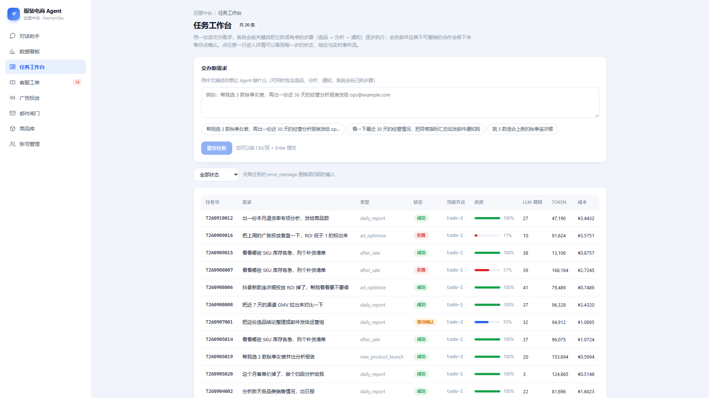
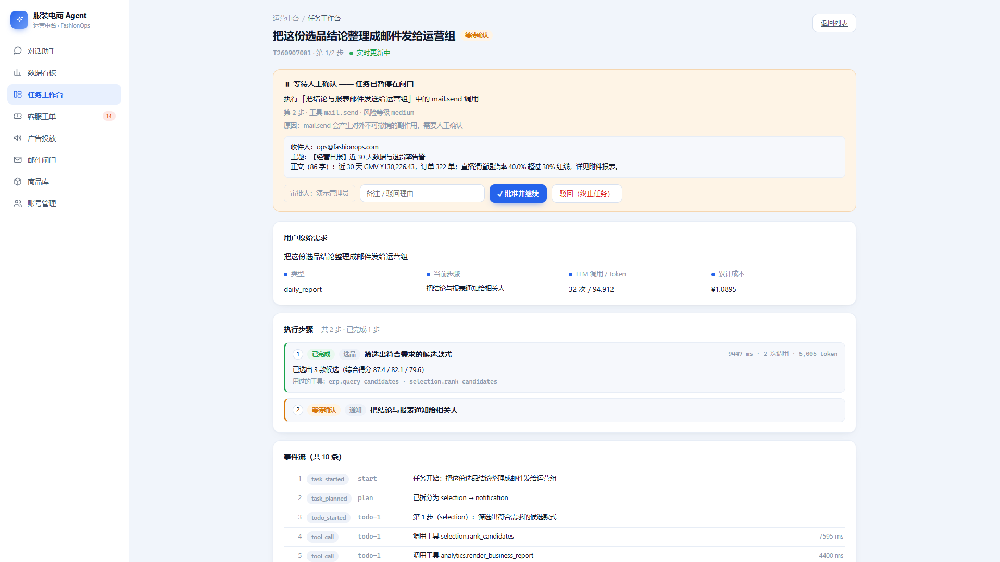
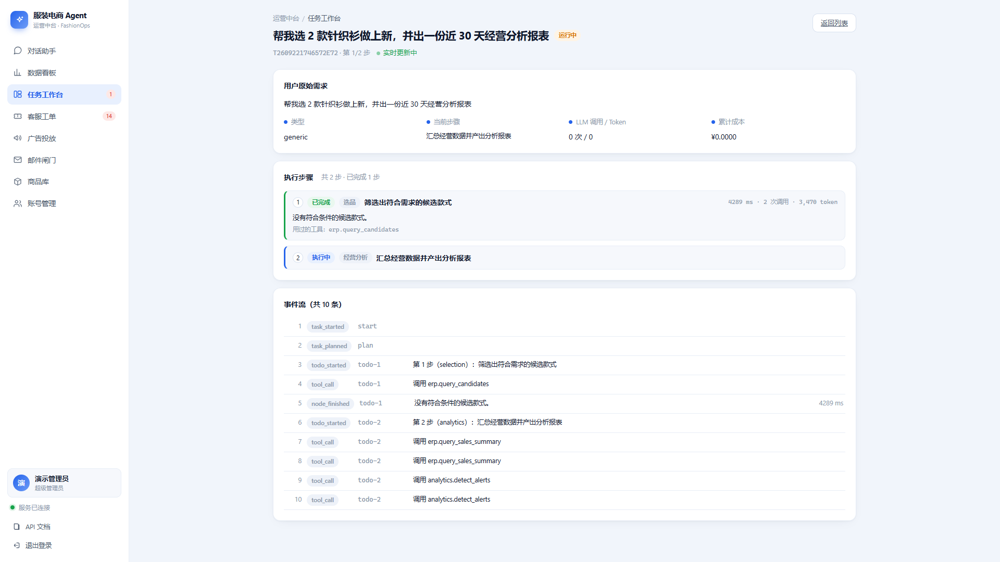

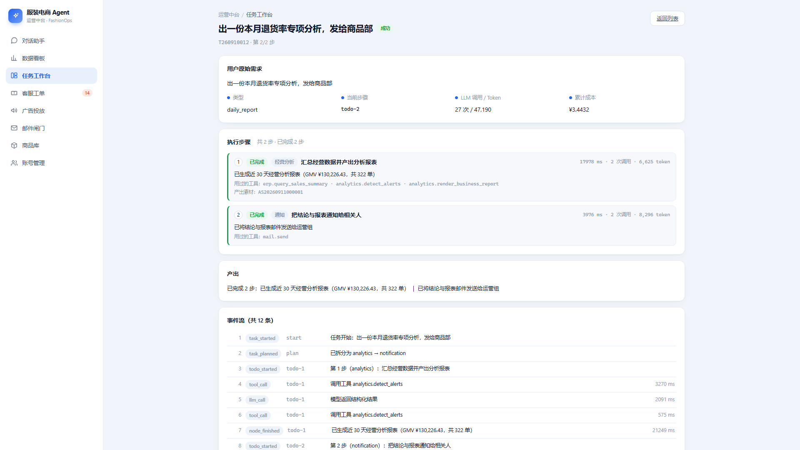

---

## 5. 邮件闸门

**功能描述**：写 / 发邮件前需人工批准。当前 `MAIL_ENABLED=false`，邮件闸口**默认阻断并保留适配位**（真实 SMTP 待接入），界面可查看待发 / 已发邮件。

**使用教程**：打开 `/emails`，查看邮件列表与审批状态。

**测试数据**：`email_messages` 表 30 行（见 `outputs/db-info.txt`）。

**输出**：界面展示待发 / 已发邮件及「未接入」占位说明。

**截图**：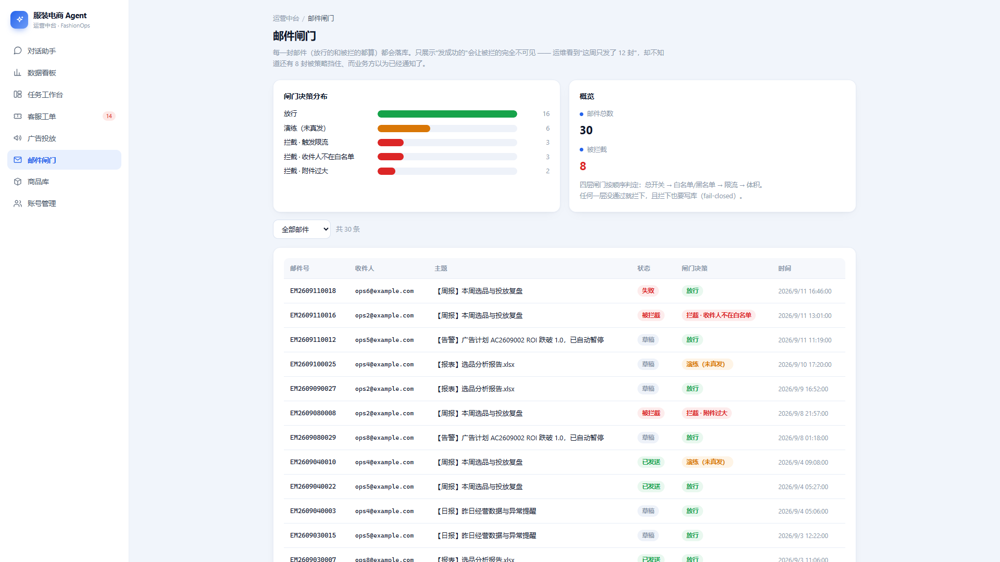

---

## 6. 客服工单

**功能描述**：客服工单列表 / 详情 / 处理流转。

**使用教程**：打开 `/tickets` 查看与处理工单。

**测试数据**：`tickets` 表 60 行，其中 14 张升级（escalated）。

**截图**：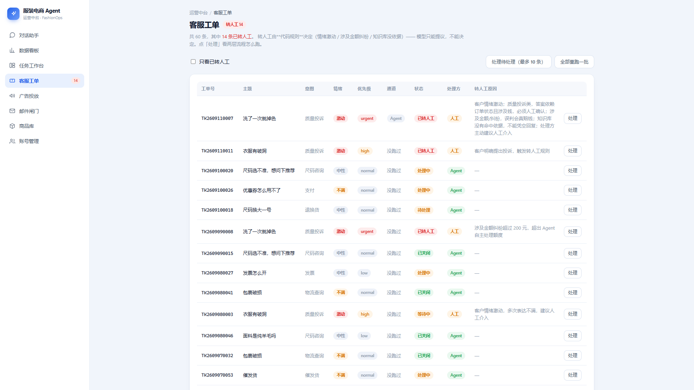

---

## 7. 广告投放

**功能描述**：广告计划管理（创建 / 查看投放计划与指标）。

**使用教程**：打开 `/campaigns`。

**测试数据**：`ad_campaigns` 表 12 行。

**截图**：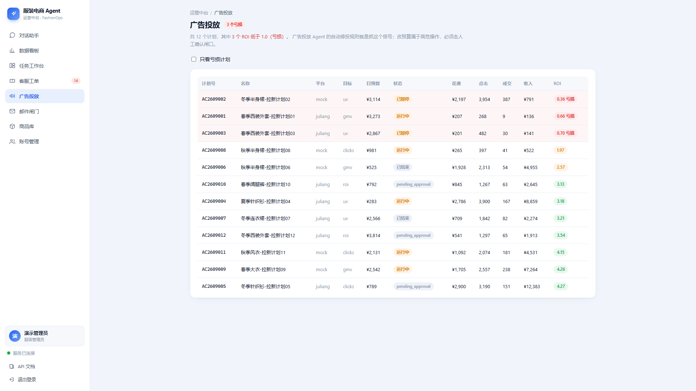

---

## 8. 商品库

**功能描述**：商品 / SKU / 库存浏览。

**使用教程**：打开 `/products`。

**测试数据**：`products` 60 / `skus` 512 / `inventory` 7549 行；缺货 SKU 76。

**截图**：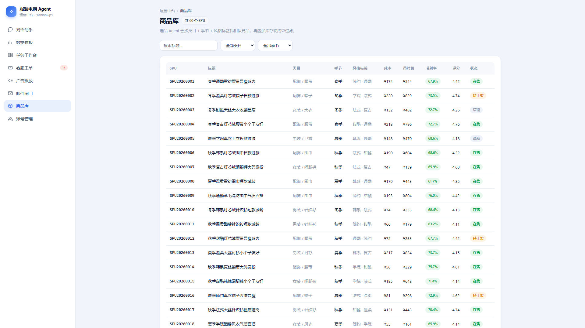

---

## 9. 账号管理（RBAC）

**功能描述**：用户 / 角色 / 权限管理，支撑登录认证的 RBAC。

**使用教程**：打开 `/accounts`，查看用户、角色与权限分配。

**测试数据**：`users` 7 / `roles` 6 / `permissions` 19 / `role_permissions` 63 行。

**截图**：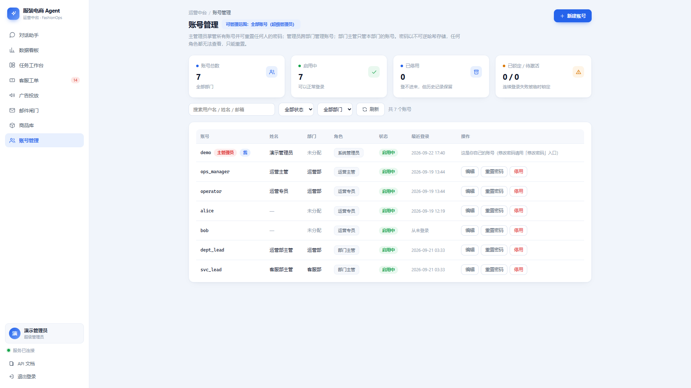

---

## 10. 知识库 RAG（混合检索）

**功能描述**：KB 混合检索 = 稠密语义向量 + 本地词法稀疏向量（TF-IDF，jieba 可选 + bigram 兜底），在 Qdrant 内用 `FusionQuery(RRF)` 融合。17 篇业务文档切分为 chunk 入库。

**使用教程**（CLI）：
```bash
fashionops-kb index        # 建索引（附稀疏向量 + 落盘 IDF）
fashionops-kb stats        # 看索引状态
fashionops-kb search "退货怎么处理" --top-k 3
```
或在对话里直接问知识类问题（见 §2 的 `03c-chat-rag.png`）。

**测试数据**：`退货怎么处理` → 期望命中「退换货」类文档。

**输出**（`outputs/kb-search.txt`）：
```
查询: 退货怎么处理
  [1] score=0.8333  KB0004  [退换货] 支持七天无理由吗
  [2] score=0.5000  KB0006  [退换货] 换货要多久
  [3] score=0.3333  KB0007  [退换货] 洗过还能退吗
```
（RRF 融合分：第一名 0.8333，正确命中「七天无理由」文档。重建索引输出见 `outputs/kb-index.txt`，状态见 `outputs/kb-stats.txt`。）

**截图**：对话中触发的知识库检索 —— 

---

## 11. 工具网关（限流 / 熔断 / 审计 / 权限）

**功能描述**：所有外部工具调用被网关统一包装——限流、熔断、权限校验、审计日志。

**测试数据**：`audit_logs` 表 373 行（见 `outputs/db-info.txt`），证明调用全程留痕。

**输出**：审计日志落库，可在账号 / 后台追溯每次工具调用。

---

## 12. API 文档

**功能描述**：Swagger UI（`/docs`，需登录）+ 机器可读的 OpenAPI 规范（`/openapi.json`）。

**使用教程**：登录后访问 `/docs`；或直接拉 `http://127.0.0.1:8010/openapi.json`。

**测试数据**：GET `/openapi.json` 返回完整规范 JSON。

**截图**：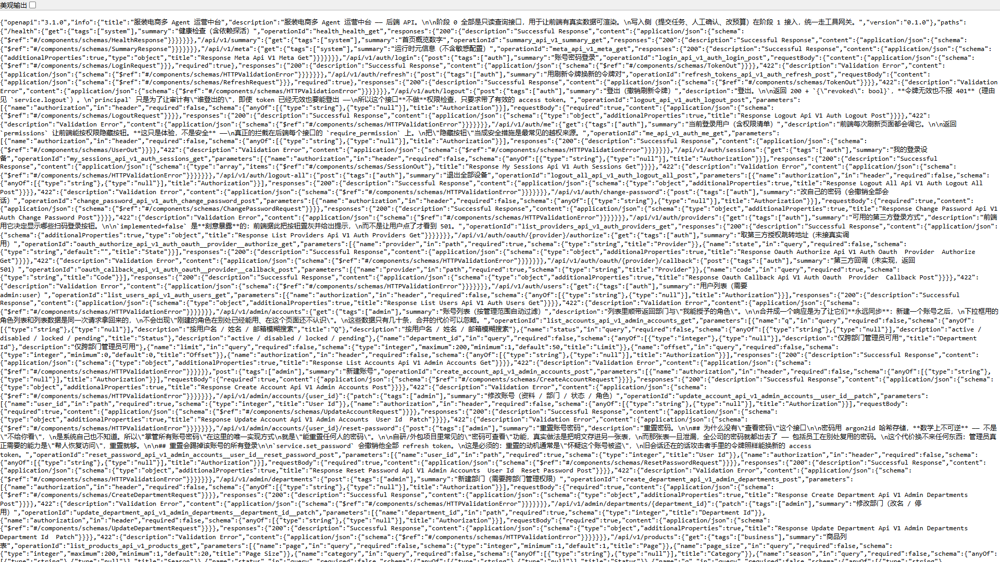

---

## 13. 配置自检

**功能描述**：`fashionops-config check` 校验 `.env` 配置项（102 个已知项）完整性。

**使用教程**：`fashionops-config check`

**测试数据**：当前 `.env`

**输出**（`outputs/config-check.txt`）：
```
配置体检
  配置文件 : ...\.env
  已知配置项: 102 个
  ✓ 没发现问题
```

---

## 14. 数据库状态

**功能描述**：`fashionops-db info` 校验数据库连接并列出所有表行数。

**使用教程**：`fashionops-db info`

**测试数据**：MySQL `fashionops`，29 张表。

**输出**（`outputs/db-info.txt` 节选）：
```
后端: MySQL   模型表数: 29   迁移版本: d3e4f5a6b7c8
  ✓ products 60  ✓ skus 512  ✓ inventory 7549  ✓ orders 800
  ✓ kb_articles 17  ✓ tickets 60  ✓ tasks 21  ✓ audit_logs 373 ...
  合计 10277 行
```

---

## 结论

- 14 项业务功能全部跑通：登录、对话编排、看板、任务（含 SSE/审批/产物）、邮件闸门、工单、广告、商品、账号、知识库 RAG、工具网关、API 文档、配置自检、数据库。
- **测试发现 1 个真实回归**（Phase 3 混合检索 `FusionQuery` 在 `qdrant-client==1.19.0` 下报错），已定位并修复，重建索引后检索正常。
- 环境内置数据完整（10277 行 / 29 表），可支撑演示与二次开发。
